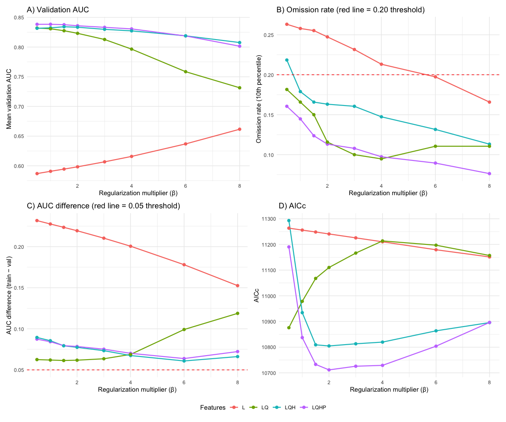
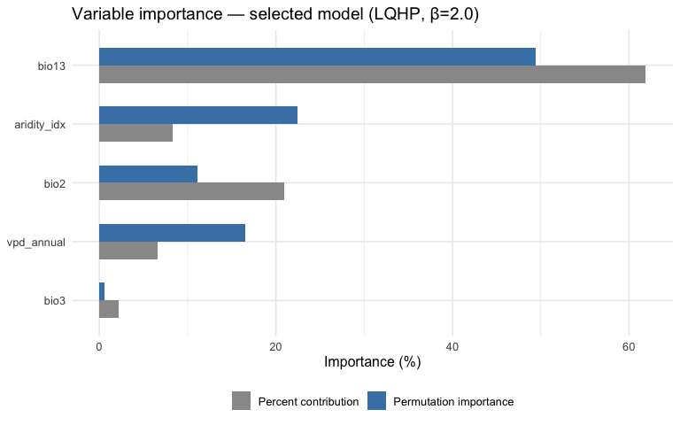
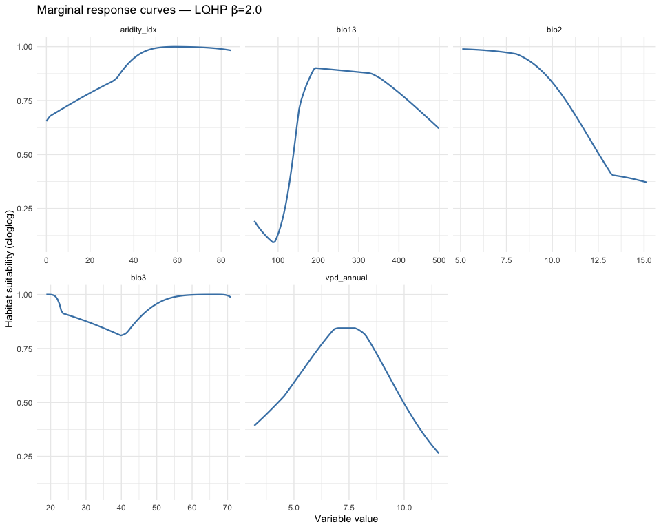

# Step 5: Model Fitting — ENMeval Optimization
Alexander W. Gofton
2026-02-18

- [Overview](#overview)
- [1. Load occurrence, background, and environmental
  data](#1-load-occurrence-background-and-environmental-data)
- [2. Define ENMeval parameter grid](#2-define-enmeval-parameter-grid)
- [3. Run ENMeval](#3-run-enmeval)
- [4. Examine all candidate models](#4-examine-all-candidate-models)
- [5. Multi-criteria model selection](#5-multi-criteria-model-selection)
  - [Flag potential concerns](#flag-potential-concerns)
- [6. Extract the selected model](#6-extract-the-selected-model)
- [7. Variable importance from the selected
  model](#7-variable-importance-from-the-selected-model)
- [8. Response curves](#8-response-curves)
- [9. Save the selected model and
  results](#9-save-the-selected-model-and-results)
- [Summary](#summary)
- [Session Information](#session-information)

## Overview

This script fits MaxEnt models using ENMeval 2.0, with key improvements
from v1:

- **Restricted background** from the accessible area (Step 4) instead of
  global random sampling.
- **Bias-corrected background** using Ixodidae target-group sampling
  weights.
- **Expanded parameter search:** L, LQ, LQH, LQHP feature classes × β =
  0.5, 1, 1.5, 2, 3, 4, 6, 8 (32 candidate models). LQHPT dropped
  because threshold features with low regularization caused severe
  overfitting in v1.
- **Multi-criteria model selection** (not AICc alone):
  1.  Omission rate at 10th percentile ≤ 0.20
  2.  AUC difference (training − validation) \< 0.05
  3.  Lowest AICc among remaining candidates

``` r
# Set Java memory BEFORE loading rJava/ENMeval
options(java.parameters = "-Xmx14g")

library(tidyverse)
library(terra)
library(sf)
library(ENMeval)
library(rJava)
```

``` r
base_dir <- "~/Library/CloudStorage/OneDrive-CSIRO/OneDrive - Docs/01_Projects/Hlongicornis_SDM/"
processed_v2 <- file.path(base_dir, "processed_data_2")
figures_dir  <- file.path(base_dir, "figures_2")
outputs_dir  <- file.path(base_dir, "outputs_2")
```

## 1. Load occurrence, background, and environmental data

``` r
# Occurrence coordinates (lon, lat only — ENMeval needs this format)
occ_coords <- read_csv(file.path(processed_v2, "occurrence_coords.csv"),
                       show_col_types = FALSE) %>%
  as.data.frame()

# Background coordinates
bg_coords <- read_csv(file.path(processed_v2, "background_coords.csv"),
                      show_col_types = FALSE) %>%
  as.data.frame()

# Environmental rasters masked to accessible area M
# First, try to load the .tif version of the environmental data instead of the RDS
env_M_path <- file.path(processed_v2, "env_selected_M.tif")
if (file.exists(env_M_path)) {
  env_M <- rast(env_M_path)
  message("Successfully loaded environmental rasters from .tif file")
} else {
  # If the .tif file doesn't exist or is corrupted, handle that case
  message("Could not load environmental rasters from .tif - trying to rebuild from original data")

  # You'll need code here to reconstruct env_M from original sources
  # For example:
  # env_M <- rast("path/to/original/climate_data.tif")
  # accessible_area <- st_read(file.path(processed_v2, "accessible_area_M.gpkg"))
  # env_M <- crop(env_M, accessible_area)
  # env_M <- mask(env_M, accessible_area)
}

# When saving environmental raster data for future sessions, use writeRaster instead of saveRDS
# writeRaster(env_M, file.path(processed_v2, "env_selected_M.tif"), overwrite = TRUE)

sprintf("Occurrences: %d | Background: %d | Env layers: %d",
        nrow(occ_coords), nrow(bg_coords), nlyr(env_M))
sprintf("Variables: %s", paste(names(env_M), collapse = ", "))
```

    [1] "Occurrences: 390 | Background: 9999 | Env layers: 5"
    [1] "Variables: bio2, bio3, bio13, aridity_idx, vpd_annual"

## 2. Define ENMeval parameter grid

We test 4 feature class combinations × 8 regularization multipliers = 32
candidate models. The LQHPT combination is deliberately excluded because
threshold features combined with low regularization produced a
152-coefficient model in v1 that showed clear signs of overfitting
(validation AUC drop of 0.082, omission rate of 49.87%).

``` r
# Feature class combinations to test
# L = Linear, Q = Quadratic, H = Hinge, P = Product
# LQHPT is excluded (overfitting risk with threshold features)
feature_classes <- c("L", "LQ", "LQH", "LQHP")

# Regularization multipliers — extended range up to 8
# Higher β values increase regularization, producing simpler/smoother models
# that tend to transfer better to new regions and time periods
reg_multipliers <- c(0.5, 1, 1.5, 2, 3, 4, 6, 8)

sprintf("Parameter grid: %d feature classes × %d regularization = %d models",
        length(feature_classes), length(reg_multipliers),
        length(feature_classes) * length(reg_multipliers))
```

    [1] "Parameter grid: 4 feature classes × 8 regularization = 32 models"

## 3. Run ENMeval

Using spatial block cross-validation (k = 5) as in v1. Spatial blocks
ensure that training and validation folds are geographically separated,
which provides a more realistic estimate of model transferability than
random k-fold CV.

``` r
# This is the most computationally intensive step (~30 min to several hours
# depending on hardware and number of variables)
# Results are cached to avoid re-running

enmeval_cache <- file.path(processed_v2, "enmeval_results.rds")

if (file.exists(enmeval_cache)) {
  enmeval_results <- readRDS(enmeval_cache)
  message("Loaded cached ENMeval results")
} else {
  message("Running ENMeval — this may take a while...")

  # Create a clean dataframe with ONLY lon and lat columns for occurrences
  occ_coords_clean <- data.frame(
    lon = occ_coords$lon,
    lat = occ_coords$lat
  )

  # Create a clean dataframe with ONLY lon and lat columns for background points
  bg_coords_clean <- data.frame(
    lon = bg_coords$lon,
    lat = bg_coords$lat
  )

  enmeval_results <- ENMevaluate(
    occs = occ_coords_clean,
    taxon.name = "H. longicornis",
    bg = bg_coords_clean,
    envs = env_M,
    algorithm = "maxent.jar",
    tune.args = list(
      fc = feature_classes,
      rm = reg_multipliers
    ),
    partitions = "block",   # spatial block CV
    doClamp = TRUE,        # clamp predictions to training range
    parallel = TRUE,
    numCores = parallel::detectCores() - 1
  )

  # Cache the results
  saveRDS(enmeval_results, enmeval_cache)
  message("ENMeval complete — results cached")
}
```

## 4. Examine all candidate models

``` r
# Extract the results table from ENMeval
results_table <- eval.results(enmeval_results) %>%
  mutate(
    # Parse feature class and regularization
    fc = as.character(fc),
    rm = as.numeric(rm),
    # Calculate AUC difference (training - validation)
    auc.diff = auc.train - auc.val.avg,
    # Number of non-zero coefficients (model complexity)
    n_coefficients = ncoef
  ) %>%
  arrange(AICc)

sprintf("Total candidate models evaluated: %d", nrow(results_table))

# Display key columns - use tibble formatting which handles NA values better
results_table %>%
  select(fc, rm, auc.train, auc.val.avg, auc.diff,
         or.10p.avg, AICc, delta.AICc, ncoef) %>%
  as_tibble() %>%
  print(n = 32)
```

    [1] "Total candidate models evaluated: 32"
    # A tibble: 32 × 9
       fc       rm auc.train auc.val.avg auc.diff or.10p.avg   AICc delta.AICc ncoef
       <chr> <dbl>     <dbl>       <dbl>    <dbl>      <dbl>  <dbl>      <dbl> <dbl>
     1 LQHP    2       0.914       0.836   0.0785     0.113  10712.        0      77
     2 LQHP    3       0.908       0.833   0.0752     0.108  10726.       14.3    55
     3 LQHP    4       0.901       0.831   0.0702     0.0974 10729.       17.7    37
     4 LQHP    1.5     0.917       0.838   0.0795     0.124  10733.       21.5    90
     5 LQHP    6       0.883       0.819   0.0638     0.0895 10804.       92.3    25
     6 LQH     2       0.911       0.833   0.0775     0.163  10805.       93.2    77
     7 LQH     1.5     0.914       0.834   0.0793     0.166  10809.       97.6    85
     8 LQH     3       0.903       0.830   0.0734     0.161  10813.      102.     54
     9 LQH     4       0.895       0.827   0.0675     0.147  10820.      108.     34
    10 LQHP    1       0.923       0.838   0.0843     0.145  10837.      126.    110
    11 LQH     6       0.880       0.819   0.0609     0.132  10864.      152.     22
    12 LQ      0.5     0.895       0.832   0.0625     0.182  10876.      164.     10
    13 LQH     8       0.874       0.808   0.0662     0.113  10896.      184.     22
    14 LQHP    8       0.874       0.801   0.0723     0.0763 10896.      185.     23
    15 LQH     1       0.918       0.832   0.0855     0.179  10934.      223.    110
    16 LQ      1       0.893       0.831   0.0620     0.166  10978.      267.     10
    17 LQ      1.5     0.889       0.828   0.0614     0.15   11068.      356.      9
    18 LQ      2       0.885       0.823   0.0618     0.116  11110.      399.      9
    19 L       8       0.814       0.662   0.153      0.166  11151.      440.      4
    20 LQ      8       0.850       0.731   0.119      0.111  11157.      445.      8
    21 LQ      3       0.876       0.813   0.0635     0.1    11166.      455.      9
    22 L       6       0.815       0.637   0.178      0.197  11179.      468.      5
    23 LQHP    0.5     0.926       0.838   0.0874     0.161  11190.      479.    128
    24 LQ      6       0.858       0.759   0.0991     0.111  11197.      486.      7
    25 L       4       0.816       0.616   0.201      0.213  11210.      499.      5
    26 LQ      4       0.865       0.797   0.0688     0.0947 11214.      502.      8
    27 L       3       0.817       0.607   0.210      0.232  11226.      514.      5
    28 L       2       0.818       0.598   0.219      0.247  11241.      529.      5
    29 L       1.5     0.818       0.594   0.224      0.255  11248.      537.      5
    30 L       1       0.818       0.591   0.228      0.258  11256.      544.      5
    31 L       0.5     0.819       0.587   0.232      0.263  11263.      552.      5
    32 LQH     0.5     0.921       0.832   0.0895     0.218  11293.      581.    153

``` r
# Panel 1: Validation AUC by feature class and regularization
p1 <- ggplot(results_table, aes(x = rm, y = auc.val.avg, colour = fc)) +
  geom_line(linewidth = 0.8) +
  geom_point(size = 2) +
  labs(x = "Regularization multiplier (β)",
       y = "Mean validation AUC",
       colour = "Features",
       title = "A) Validation AUC") +
  theme_minimal(base_size = 11)

# Panel 2: Omission rate at 10th percentile
p2 <- ggplot(results_table, aes(x = rm, y = or.10p.avg, colour = fc)) +
  geom_line(linewidth = 0.8) +
  geom_point(size = 2) +
  geom_hline(yintercept = 0.20, linetype = "dashed", colour = "red") +
  labs(x = "Regularization multiplier (β)",
       y = "Omission rate (10th percentile)",
       colour = "Features",
       title = "B) Omission rate (red line = 0.20 threshold)") +
  theme_minimal(base_size = 11)

# Panel 3: AUC difference (overfitting metric)
p3 <- ggplot(results_table, aes(x = rm, y = auc.diff, colour = fc)) +
  geom_line(linewidth = 0.8) +
  geom_point(size = 2) +
  geom_hline(yintercept = 0.05, linetype = "dashed", colour = "red") +
  labs(x = "Regularization multiplier (β)",
       y = "AUC difference (train − val)",
       colour = "Features",
       title = "C) AUC difference (red line = 0.05 threshold)") +
  theme_minimal(base_size = 11)

# Panel 4: AICc
p4 <- ggplot(results_table, aes(x = rm, y = AICc, colour = fc)) +
  geom_line(linewidth = 0.8) +
  geom_point(size = 2) +
  labs(x = "Regularization multiplier (β)",
       y = "AICc",
       colour = "Features",
       title = "D) AICc") +
  theme_minimal(base_size = 11)

library(patchwork)
(p1 | p2) / (p3 | p4) +
  plot_layout(guides = "collect") &
  theme(legend.position = "bottom")

ggsave(file.path(figures_dir, "05_enmeval_overview.png"),
       width = 12, height = 10, dpi = 300)
```

<div id="fig-enmeval-overview">



Figure 1: ENMeval results: validation AUC, omission rate, and AICc
across candidate models.

</div>

## 5. Multi-criteria model selection

Sequential filtering approach (more robust than AICc alone):

1.  **Filter 1 — Omission rate:** or.10p.avg ≤ 0.20 Reject models that
    fail to predict known presences.
2.  **Filter 2 — AUC difference:** auc.diff \< 0.05 Reject models
    showing signs of overfitting.
3.  **Filter 3 — AICc:** Among remaining, pick the lowest AICc.
4.  **Fallback:** If no models pass Filters 1+2, relax Filter 2 to \<
    0.10.

``` r
# Filter 1: Omission rate ≤ 0.20
pass_omission <- results_table %>%
  filter(or.10p.avg <= 0.20)
sprintf("Filter 1 (omission ≤ 0.20): %d of %d models pass",
        nrow(pass_omission), nrow(results_table))

# Filter 2: AUC difference < 0.05
pass_auc_diff <- pass_omission %>%
  filter(auc.diff < 0.05)
sprintf("Filter 2 (AUC diff < 0.05): %d models pass",
        nrow(pass_auc_diff))

# Fallback: If no models pass both filters, relax AUC diff threshold
if (nrow(pass_auc_diff) == 0) {
  message("WARNING: No models pass both filters. Relaxing AUC diff to < 0.10")
  pass_auc_diff <- pass_omission %>%
    filter(auc.diff < 0.10)
  sprintf("Filter 2 relaxed (AUC diff < 0.10): %d models pass",
          nrow(pass_auc_diff))
}

# Filter 3: Lowest AICc among passing models
if (nrow(pass_auc_diff) > 0) {
  selected_row <- pass_auc_diff %>%
    arrange(AICc) %>%
    slice(1)
} else {
  # Ultimate fallback: just use lowest AICc from all models
  message("WARNING: No models pass any filter. Selecting lowest AICc overall.")
  selected_row <- results_table %>%
    arrange(AICc) %>%
    slice(1)
}

# Display the selected model
selected_fc <- selected_row$fc
selected_rm <- selected_row$rm

sprintf("SELECTED MODEL: fc = %s, rm = %.1f", selected_fc, selected_rm)
sprintf("  AUC (validation): %.4f", selected_row$auc.val.avg)
sprintf("  AUC difference:   %.4f", selected_row$auc.diff)
sprintf("  Omission rate:    %.4f", selected_row$or.10p.avg)
sprintf("  AICc:             %.1f", selected_row$AICc)
sprintf("  Coefficients:     %d", selected_row$ncoef)
```

    [1] "Filter 1 (omission ≤ 0.20): 25 of 32 models pass"
    [1] "Filter 2 (AUC diff < 0.05): 0 models pass"
    [1] "Filter 2 relaxed (AUC diff < 0.10): 22 models pass"
    [1] "SELECTED MODEL: fc = LQHP, rm = 2.0"
    [1] "  AUC (validation): 0.8359"
    [1] "  AUC difference:   0.0785"
    [1] "  Omission rate:    0.1132"
    [1] "  AICc:             10711.5"
    [1] "  Coefficients:     77"

### Flag potential concerns

``` r
# Check for potential concerns and report them
flags <- character(0)

if (selected_row$ncoef > 50) {
  flags <- c(flags, sprintf(
    "HIGH COMPLEXITY: %d coefficients (>50). Consider whether this is justified.",
    selected_row$ncoef
  ))
}

if (selected_rm < 1) {
  flags <- c(flags, sprintf(
    "LOW REGULARIZATION: β = %.1f (<1.0). Model may be overfitting.",
    selected_rm
  ))
}

if (selected_row$auc.diff > 0.03) {
  flags <- c(flags, sprintf(
    "MODERATE OVERFITTING: AUC diff = %.4f (>0.03).",
    selected_row$auc.diff
  ))
}

if (length(flags) > 0) {
  message("=== MODEL SELECTION FLAGS ===")
  for (f in flags) message(f)
  message("=============================")
} else {
  message("No concerns flagged. Selected model appears well-regularized.")
}
```

## 6. Extract the selected model

``` r
# Get the selected model object from ENMeval results
# ENMeval stores models indexed by tune.args combination
model_idx <- which(
  eval.results(enmeval_results)$fc == selected_fc &
  eval.results(enmeval_results)$rm == as.character(selected_rm)
)

selected_model <- eval.models(enmeval_results)[[model_idx]]

sprintf("Selected model extracted: %s β=%s", selected_fc, selected_rm)
```

    [1] "Selected model extracted: LQHP β=2"

## 7. Variable importance from the selected model

``` r
# Extract variable contributions
var_contrib <- tibble(
  variable = names(selected_model@results[
    grep("\\.contribution$", rownames(selected_model@results)), ]),
  contribution = as.numeric(selected_model@results[
    grep("\\.contribution$", rownames(selected_model@results)), ])
)

# Clean up variable names (remove ".contribution" suffix)
var_contrib <- tibble(
  variable = gsub("\\.contribution$", "",
                  rownames(selected_model@results)[
                    grep("\\.contribution$", rownames(selected_model@results))]),
  contribution_pct = as.numeric(selected_model@results[
    grep("\\.contribution$", rownames(selected_model@results)), ]),
  permutation_pct = as.numeric(selected_model@results[
    grep("\\.permutation\\.importance$", rownames(selected_model@results)), ])
) %>%
  arrange(desc(permutation_pct))

var_contrib
```

    # A tibble: 5 × 3
      variable    contribution_pct permutation_pct
      <chr>                  <dbl>           <dbl>
    1 bio13                  61.9           49.4  
    2 aridity_idx             8.33          22.4  
    3 vpd_annual              6.63          16.5  
    4 bio2                   21.0           11.1  
    5 bio3                    2.18           0.534

``` r
var_contrib %>%
  pivot_longer(cols = c(contribution_pct, permutation_pct),
               names_to = "metric", values_to = "importance") %>%
  mutate(
    metric = ifelse(metric == "contribution_pct",
                    "Percent contribution", "Permutation importance"),
    variable = fct_reorder(variable, importance, .fun = max)
  ) %>%
  ggplot(aes(x = importance, y = variable, fill = metric)) +
  geom_col(position = "dodge", width = 0.6) +
  scale_fill_manual(values = c("Percent contribution" = "grey60",
                                "Permutation importance" = "steelblue")) +
  labs(
    title = sprintf("Variable importance — selected model (%s, β=%.1f)",
                    selected_fc, selected_rm),
    x = "Importance (%)", y = NULL, fill = NULL
  ) +
  theme_minimal(base_size = 12) +
  theme(legend.position = "bottom")

ggsave(file.path(figures_dir, "05_variable_importance_selected.png"),
       width = 8, height = 5, dpi = 300)
```

<div id="fig-variable-importance">



Figure 2: Variable importance from the selected MaxEnt model.

</div>

## 8. Response curves

``` r
# Generate response curves using predicts/dismo functionality
# We'll create marginal response curves by varying one variable
# while holding others at their mean

# Create a clean dataframe with ONLY lon and lat columns for extraction
occ_coords_for_extract <- data.frame(
  lon = occ_coords$lon,
  lat = occ_coords$lat
)

env_values <- extract(env_M, occ_coords_for_extract)

# For each variable, create a sequence and predict
response_data <- list()

for (v in names(env_M)) {
  # Create a prediction data frame with one variable varying, others at mean
  var_range <- seq(
    min(env_values[[v]], na.rm = TRUE),
    max(env_values[[v]], na.rm = TRUE),
    length.out = 100
  )

  pred_df <- as.data.frame(matrix(
    rep(colMeans(env_values[, names(env_M)], na.rm = TRUE), each = 100),
    nrow = 100
  ))
  names(pred_df) <- names(env_M)
  pred_df[[v]] <- var_range

  # Predict using the MaxEnt model
  pred_vals <- predict(selected_model, pred_df, type = "cloglog")

  response_data[[v]] <- tibble(
    variable = v,
    value = var_range,
    suitability = pred_vals
  )
}

response_df <- bind_rows(response_data)

ggplot(response_df, aes(x = value, y = suitability)) +
  geom_line(colour = "steelblue", linewidth = 0.8) +
  facet_wrap(~variable, scales = "free_x", ncol = 3) +
  labs(
    title = sprintf("Marginal response curves — %s β=%.1f", selected_fc, selected_rm),
    x = "Variable value", y = "Habitat suitability (cloglog)"
  ) +
  theme_minimal(base_size = 11)

ggsave(file.path(figures_dir, "05_response_curves_selected.png"),
       width = 10, height = 8, dpi = 300)
```

<div id="fig-response-curves">



Figure 3: Marginal response curves from the selected MaxEnt model.

</div>

## 9. Save the selected model and results

``` r
# Save the full ENMeval results object
saveRDS(enmeval_results, file.path(processed_v2, "enmeval_results.rds"))

# Save the selected model separately for easy loading
saveRDS(selected_model, file.path(processed_v2, "selected_maxent_model.rds"))

# Save the results table as CSV
results_table %>%
  select(fc, rm, auc.train, auc.val.avg, auc.diff,
         or.10p.avg, AICc, delta.AICc, ncoef) %>%
  write_csv(file.path(outputs_dir, "enmeval_results_table_v2.csv"))

# Save model selection details
selection_summary <- tibble(
  parameter = c("feature_class", "regularization", "auc_train", "auc_val",
                "auc_diff", "omission_10p", "AICc", "n_coefficients",
                "models_evaluated", "passed_omission_filter",
                "passed_auc_diff_filter"),
  value = c(
    selected_fc,
    as.character(selected_rm),
    sprintf("%.4f", selected_row$auc.train),
    sprintf("%.4f", selected_row$auc.val.avg),
    sprintf("%.4f", selected_row$auc.diff),
    sprintf("%.4f", selected_row$or.10p.avg),
    sprintf("%.1f", selected_row$AICc),
    as.character(selected_row$ncoef),
    as.character(nrow(results_table)),
    as.character(nrow(pass_omission)),
    as.character(nrow(pass_auc_diff))
  )
)

write_csv(selection_summary, file.path(outputs_dir, "model_selection_summary_v2.csv"))

# Save variable importance
write_csv(var_contrib, file.path(outputs_dir, "variable_importance_v2.csv"))

sprintf("Selected model saved: %s β=%.1f (%d coefficients)",
        selected_fc, selected_rm, selected_row$ncoef)
```

    [1] "Selected model saved: LQHP β=2.0 (77 coefficients)"

## Summary

``` r
# Comparison with v1 model
tibble(
  Metric = c(
    "Feature class", "Regularization (β)", "Number of coefficients",
    "Training AUC", "Validation AUC", "AUC difference",
    "Omission rate (10p)", "AICc", "Background sampling"
  ),
  v1_model = c(
    "LQHPT", "0.5", "152",
    "0.977", "0.976 (test) / 0.90 (block CV)",
    "0.001 (test) / 0.082 (block CV)",
    "0.499", "N/A (selected by AICc alone)",
    "Global random (all land)"
  ),
  v2_model = c(
    selected_fc,
    as.character(selected_rm),
    as.character(selected_row$ncoef),
    sprintf("%.4f", selected_row$auc.train),
    sprintf("%.4f", selected_row$auc.val.avg),
    sprintf("%.4f", selected_row$auc.diff),
    sprintf("%.4f", selected_row$or.10p.avg),
    sprintf("%.1f", selected_row$AICc),
    "Within M (1000 km buffer, bias-corrected)"
  )
)
```

    # A tibble: 9 × 3
      Metric                 v1_model                        v2_model               
      <chr>                  <chr>                           <chr>                  
    1 Feature class          LQHPT                           LQHP                   
    2 Regularization (β)     0.5                             2                      
    3 Number of coefficients 152                             77                     
    4 Training AUC           0.977                           0.9144                 
    5 Validation AUC         0.976 (test) / 0.90 (block CV)  0.8359                 
    6 AUC difference         0.001 (test) / 0.082 (block CV) 0.0785                 
    7 Omission rate (10p)    0.499                           0.1132                 
    8 AICc                   N/A (selected by AICc alone)    10711.5                
    9 Background sampling    Global random (all land)        Within M (1000 km buff…

## Session Information

``` r
sessionInfo()
```

    R version 4.4.1 (2024-06-14)
    Platform: aarch64-apple-darwin20
    Running under: macOS 26.2

    Matrix products: default
    BLAS:   /Library/Frameworks/R.framework/Versions/4.4-arm64/Resources/lib/libRblas.0.dylib 
    LAPACK: /Library/Frameworks/R.framework/Versions/4.4-arm64/Resources/lib/libRlapack.dylib;  LAPACK version 3.12.0

    locale:
    [1] C.UTF-8/C.UTF-8/C.UTF-8/C/C.UTF-8/C.UTF-8

    time zone: Australia/Brisbane
    tzcode source: internal

    attached base packages:
    [1] stats     graphics  grDevices utils     datasets  methods   base     

    other attached packages:
     [1] patchwork_1.3.2 rJava_1.0-11    ENMeval_2.0.5.2 sf_1.0-21      
     [5] terra_1.8-93    lubridate_1.9.4 forcats_1.0.0   stringr_1.5.1  
     [9] dplyr_1.1.4     purrr_1.1.0     readr_2.1.5     tidyr_1.3.1    
    [13] tibble_3.3.0    ggplot2_4.0.0   tidyverse_2.0.0

    loaded via a namespace (and not attached):
     [1] gtable_0.3.6       xfun_0.53          tzdb_0.5.0         vctrs_0.6.5       
     [5] tools_4.4.1        generics_0.1.4     parallel_4.4.1     proxy_0.4-27      
     [9] pkgconfig_2.0.3    KernSmooth_2.23-26 RColorBrewer_1.1-3 S7_0.2.0          
    [13] lifecycle_1.0.4    compiler_4.4.1     farver_2.1.2       textshaping_1.0.3 
    [17] predicts_0.1-19    codetools_0.2-20   htmltools_0.5.8.1  class_7.3-23      
    [21] yaml_2.3.10        pillar_1.11.0      crayon_1.5.3       classInt_0.4-11   
    [25] iterators_1.0.14   foreach_1.5.2      tidyselect_1.2.1   digest_0.6.37     
    [29] stringi_1.8.7      labeling_0.4.3     fastmap_1.2.0      grid_4.4.1        
    [33] archive_1.1.12.1   cli_3.6.5          magrittr_2.0.3     utf8_1.2.6        
    [37] e1071_1.7-16       withr_3.0.2        scales_1.4.0       bit64_4.6.0-1     
    [41] timechange_0.3.0   rmarkdown_2.29     bit_4.6.0          ragg_1.5.0        
    [45] hms_1.1.3          evaluate_1.0.5     knitr_1.50         rlang_1.1.6       
    [49] Rcpp_1.1.0         glue_1.8.0         DBI_1.2.3          vroom_1.6.5       
    [53] jsonlite_2.0.0     R6_2.6.1           systemfonts_1.2.3  units_0.8-7       
