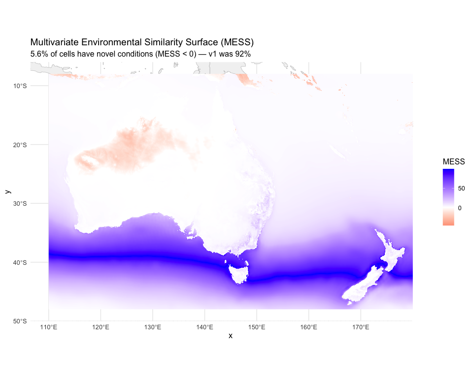
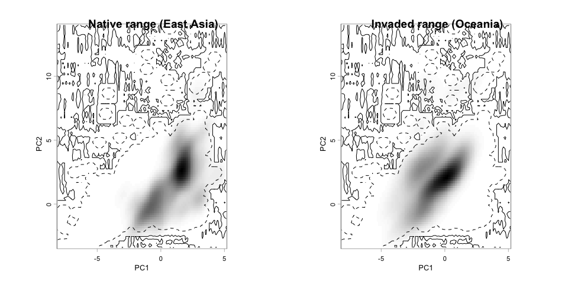

# Step 6: Model Evaluation
Alexander W. Gofton
2026-02-18

- [Overview](#overview)
- [1. Load model, data, and environmental
  rasters](#1-load-model-data-and-environmental-rasters)
- [2. Threshold selection](#2-threshold-selection)
- [3. Discrimination metrics](#3-discrimination-metrics)
- [4. Side-by-side comparison with
  v1](#4-side-by-side-comparison-with-v1)
- [5. MESS analysis (Australia/NZ)](#5-mess-analysis-australianz)
- [6. Biological validation](#6-biological-validation)
- [7. Leave-One-Region-Out (LORO)
  cross-validation](#7-leave-one-region-out-loro-cross-validation)
- [8. Ecospat niche overlap analysis](#8-ecospat-niche-overlap-analysis)
- [9. Save evaluation outputs](#9-save-evaluation-outputs)
- [Summary](#summary)
- [Session Information](#session-information)

## Overview

Comprehensive model evaluation with side-by-side comparison to v1
metrics. This step covers:

- Standard discrimination metrics (AUC, TSS, Kappa)
- MESS analysis for extrapolation risk
- Biological validation against known distribution
- Ecospat niche overlap (Schoener’s D, Warren’s I)
- Principled threshold selection (MaxSS, 10th percentile, equal
  sens/spec)
- Leave-one-region-out (LORO) cross-validation for transferability

``` r
options(java.parameters = "-Xmx12g")

library(tidyverse)
library(terra)
library(sf)
library(predicts)
library(rJava)
library(ecospat)
library(ade4)
library(dismo)
library(rnaturalearth)
library(rnaturalearthdata)
```

``` r
base_dir <- "~/Library/CloudStorage/OneDrive-CSIRO/OneDrive - Docs/01_Projects/Hlongicornis_SDM/"
processed_v2 <- file.path(base_dir, "processed_data_2")
figures_dir  <- file.path(base_dir, "figures_2")
outputs_dir  <- file.path(base_dir, "outputs_2")
```

## 1. Load model, data, and environmental rasters

``` r
# The selected MaxEnt model from Step 5
selected_model <- readRDS(file.path(processed_v2, "selected_maxent_model.rds"))

# ENMeval results for cross-validation metrics
enmeval_results <- readRDS(file.path(processed_v2, "enmeval_results.rds"))

# Occurrence data with region assignments
occ <- read_csv(file.path(processed_v2, "occurrences_stratified.csv"),
                show_col_types = FALSE)
occ_coords <- read_csv(file.path(processed_v2, "occurrence_coords.csv"),
                       show_col_types = FALSE)

# Background points with climate values
bg_points <- read_csv(file.path(processed_v2, "background_points.csv"),
                      show_col_types = FALSE)

# Environmental rasters
env_M     <- readRDS(file.path(processed_v2, "env_selected_M.rds"))
env_aus_nz <- rast(file.path(processed_v2, "env_selected_aus_nz.tif"))

# Accessible area polygon
accessible_area <- st_read(file.path(processed_v2, "accessible_area_M.gpkg"),
                           quiet = TRUE)

# Model selection summary
model_summary <- read_csv(file.path(outputs_dir, "model_selection_summary_v2.csv"),
                          show_col_types = FALSE)

sprintf("Occurrences: %d | Background: %d", nrow(occ), nrow(bg_points))
```

    [1] "Occurrences: 390 | Background: 9999"

## 2. Threshold selection

Calculate principled thresholds from the training data rather than using
an arbitrary 0.5 cutoff.

``` r
# Predict suitability at presence and background locations
selected_vars <- names(env_M)

# Extract environmental values at presence points
pres_env <- extract(env_M, as.matrix(occ_coords[, c("lon", "lat")]))
pres_pred <- predict(selected_model, pres_env, type = "cloglog")

# Extract environmental values at background points
bg_env <- bg_points %>% dplyr::select(all_of(selected_vars))
bg_pred <- predict(selected_model, bg_env, type = "cloglog")

# Combine for threshold analysis
eval_data <- tibble(
  suitability = c(pres_pred, bg_pred),
  presence = c(rep(1, length(pres_pred)), rep(0, length(bg_pred)))
) %>%
  filter(!is.na(suitability))

# Calculate thresholds using predicts/dismo evaluate function
eval_obj <- evaluate(
  p = pres_pred[!is.na(pres_pred)],
  a = bg_pred[!is.na(bg_pred)]
)

# Maximum Sensitivity + Specificity (MaxSS) — our primary threshold
# This maximises the sum of sensitivity and specificity
spec_sens <- eval_obj@t[which.max(eval_obj@TPR + eval_obj@TNR)]

# 10th percentile training presence threshold
# The suitability value below which 10% of training presences fall
p10_threshold <- quantile(pres_pred, probs = 0.10, na.rm = TRUE)

# Equal sensitivity and specificity threshold
# Where sensitivity = specificity
sens_spec_diff <- abs(eval_obj@TPR - eval_obj@TNR)
equal_sens_spec <- eval_obj@t[which.min(sens_spec_diff)]

# Report all thresholds
thresholds <- tibble(
  Method = c(
    "Maximum Sensitivity + Specificity (MaxSS) [PRIMARY]",
    "10th percentile training presence",
    "Equal Sensitivity and Specificity"
  ),
  Threshold = c(spec_sens, p10_threshold, equal_sens_spec)
)
thresholds

# Use MaxSS as the primary threshold throughout
primary_threshold <- spec_sens
sprintf("Primary threshold (MaxSS): %.4f", primary_threshold)
```

    # A tibble: 3 × 2
      Method                                              Threshold
      <chr>                                                   <dbl>
    1 Maximum Sensitivity + Specificity (MaxSS) [PRIMARY]     0.214
    2 10th percentile training presence                       0.147
    3 Equal Sensitivity and Specificity                       0.193
    [1] "Primary threshold (MaxSS): 0.2138"

## 3. Discrimination metrics

``` r
# AUC
auc_value <- eval_obj@auc

# TSS (True Skill Statistic) at the MaxSS threshold
# TSS = sensitivity + specificity - 1
tss_idx <- which.min(abs(eval_obj@t - primary_threshold))
sensitivity_at_thresh <- eval_obj@TPR[tss_idx]
specificity_at_thresh <- eval_obj@TNR[tss_idx]
tss_value <- sensitivity_at_thresh + specificity_at_thresh - 1

# Kappa at MaxSS threshold
# Calculate confusion matrix components
pred_binary <- ifelse(pres_pred >= primary_threshold, 1, 0)
bg_binary   <- ifelse(bg_pred >= primary_threshold, 1, 0)
tp <- sum(pred_binary == 1, na.rm = TRUE)
fn <- sum(pred_binary == 0, na.rm = TRUE)
fp <- sum(bg_binary == 1, na.rm = TRUE)
tn <- sum(bg_binary == 0, na.rm = TRUE)
n_total <- tp + fn + fp + tn

observed_accuracy <- (tp + tn) / n_total
expected_accuracy <- ((tp + fp) * (tp + fn) + (fn + tn) * (fp + tn)) / (n_total^2)
kappa_value <- (observed_accuracy - expected_accuracy) / (1 - expected_accuracy)

# Mean suitability at occurrence points
mean_suit_occ <- mean(pres_pred, na.rm = TRUE)

# Compile metrics
metrics <- tibble(
  Metric = c("AUC", "TSS", "Kappa", "Sensitivity (MaxSS)",
             "Specificity (MaxSS)", "Mean suitability at occurrences",
             "Primary threshold (MaxSS)"),
  Value = round(c(auc_value, tss_value, kappa_value,
                  sensitivity_at_thresh, specificity_at_thresh,
                  mean_suit_occ, primary_threshold), 4)
)

metrics
```

    # A tibble: 7 × 2
      Metric                          Value
      <chr>                           <dbl>
    1 AUC                             0.914
    2 TSS                             0.717
    3 Kappa                           0.293
    4 Sensitivity (MaxSS)             0.837
    5 Specificity (MaxSS)             0.880
    6 Mean suitability at occurrences 0.682
    7 Primary threshold (MaxSS)       0.214

## 4. Side-by-side comparison with v1

``` r
# v1 metrics (from processed_data/model_performance_summary.csv)
comparison <- tibble(
  Metric = c(
    "Training AUC",
    "Test/Validation AUC",
    "Kappa",
    "TSS",
    "Mean suitability at occurrences",
    "Number of coefficients",
    "Background sampling",
    "Primary threshold"
  ),
  v1 = c(
    "0.977", "0.976 (random) / 0.900 (block CV)",
    "0.369", "0.620",
    "0.498", "152",
    "Global random (all land)", "0.500 (arbitrary)"
  ),
  v2 = c(
    sprintf("%.4f", as.numeric(model_summary$value[model_summary$parameter == "auc_train"])),
    sprintf("%.4f", as.numeric(model_summary$value[model_summary$parameter == "auc_val"])),
    sprintf("%.4f", kappa_value),
    sprintf("%.4f", tss_value),
    sprintf("%.4f", mean_suit_occ),
    model_summary$value[model_summary$parameter == "n_coefficients"],
    "Within M (1000 km buffer, bias-corrected)",
    sprintf("%.4f (MaxSS)", primary_threshold)
  )
)

comparison
```

    # A tibble: 8 × 3
      Metric                          v1                                v2          
      <chr>                           <chr>                             <chr>       
    1 Training AUC                    0.977                             0.9144      
    2 Test/Validation AUC             0.976 (random) / 0.900 (block CV) 0.8359      
    3 Kappa                           0.369                             0.2933      
    4 TSS                             0.620                             0.7166      
    5 Mean suitability at occurrences 0.498                             0.6820      
    6 Number of coefficients          152                               77          
    7 Background sampling             Global random (all land)          Within M (1…
    8 Primary threshold               0.500 (arbitrary)                 0.2138 (Max…

## 5. MESS analysis (Australia/NZ)

MESS (Multivariate Environmental Similarity Surface) identifies cells in
the projection area where one or more environmental variables fall
outside the range observed in the training data. These cells represent
extrapolation and predictions there are unreliable.

``` r
# Training environment: values at presence + background points within M
training_env <- bind_rows(
  extract(env_M, as.matrix(occ_coords[, c("lon", "lat")])) %>%
    as_tibble() %>%
    dplyr::select(all_of(selected_vars)),
  bg_points %>% dplyr::select(all_of(selected_vars))
) %>%
  drop_na()

# Compute MESS for Australia/NZ
mess_aus_nz <- dismo::mess(raster::stack(env_aus_nz), as.data.frame(training_env), full = FALSE) %>% rast()
names(mess_aus_nz) <- "mess"

# Calculate percentage of cells with novel conditions (MESS < 0)
n_valid <- global(!is.na(mess_aus_nz), sum)[[1]]
n_novel <- global(mess_aus_nz < 0, sum, na.rm = TRUE)[[1]]
pct_novel <- round(100 * n_novel / n_valid, 1)

sprintf("MESS analysis — Australia/NZ:")
sprintf("  Valid cells:     %.0f", n_valid)
sprintf("  Novel cells:     %.0f (MESS < 0)", n_novel)
sprintf("  Extrapolation:   %.1f%%", pct_novel)
sprintf("  v1 extrapolation: 92.0%% (expected to be much lower now)")
```

    [1] "MESS analysis — Australia/NZ:"
    [1] "  Valid cells:     1612800"
    [1] "  Novel cells:     90417 (MESS < 0)"
    [1] "  Extrapolation:   5.6%"
    [1] "  v1 extrapolation: 92.0% (expected to be much lower now)"

``` r
# Convert to data frame for plotting
mess_df <- as.data.frame(mess_aus_nz, xy = TRUE) %>%
  filter(!is.na(mess))

world_map <- ne_countries(scale = "medium", returnclass = "sf")

ggplot() +
  geom_sf(data = world_map, fill = "grey95", colour = "grey70", linewidth = 0.2) +
  geom_raster(data = mess_df, aes(x = x, y = y, fill = mess)) +
  scale_fill_gradient2(
    low = "red", mid = "white", high = "blue",
    midpoint = 0, name = "MESS",
    limits = c(min(mess_df$mess), max(mess_df$mess))
  ) +
  coord_sf(xlim = c(110, 180), ylim = c(-48, -8)) +
  labs(
    title = "Multivariate Environmental Similarity Surface (MESS)",
    subtitle = sprintf("%.1f%% of cells have novel conditions (MESS < 0) — v1 was 92%%",
                       pct_novel)
  ) +
  theme_minimal(base_size = 12)

ggsave(file.path(figures_dir, "06_mess_aus_nz.png"),
       width = 10, height = 8, dpi = 300)
```

<div id="fig-mess">



Figure 1: MESS analysis for Australia/NZ. Red areas have novel climate
relative to training data.

</div>

## 6. Biological validation

Test whether the model correctly predicts suitability in areas where *H.
longicornis* is known to occur (or not occur) in Australia.

``` r
# Predict suitability across Australia/NZ
pred_aus_nz <- predict(env_aus_nz, selected_model, type = "cloglog")
names(pred_aus_nz) <- "suitability"

# 6a. Eastern coast validation (Sydney–Brisbane corridor)
# This is the core area where H. longicornis is established in Australia
# Approximate bounding box: 150-154°E, 27-34°S
east_coast_ext <- ext(150, 154, -34, -27)
pred_east_coast <- crop(pred_aus_nz, east_coast_ext)
mean_suit_east <- global(pred_east_coast, mean, na.rm = TRUE)[[1]]

# 6b. Known absence areas (central Australia, western deserts)
# Approximate bounding box: 125-140°E, 20-30°S
desert_ext <- ext(125, 140, -30, -20)
pred_desert <- crop(pred_aus_nz, desert_ext)
mean_suit_desert <- global(pred_desert, mean, na.rm = TRUE)[[1]]

# 6c. Report results with pass/fail
validation_results <- tibble(
  Check = c(
    "Eastern coast (Sydney–Brisbane): mean suitability > 0.3",
    "Central deserts: mean suitability < 0.2"
  ),
  Value = c(
    sprintf("%.4f", mean_suit_east),
    sprintf("%.4f", mean_suit_desert)
  ),
  Status = c(
    ifelse(mean_suit_east > 0.3, "PASS", "FAIL"),
    ifelse(mean_suit_desert < 0.2, "PASS", "FAIL")
  ),
  v1_Value = c("0.157 (FAILED)", "N/A")
)

validation_results

# Flag prominently if eastern coast check fails
if (mean_suit_east <= 0.3) {
  message("============================================================")
  message("WARNING: EASTERN COAST BIOLOGICAL VALIDATION FAILED")
  message(sprintf("Mean suitability = %.4f (threshold = 0.3)", mean_suit_east))
  message("The model is not predicting suitable habitat where H. longicornis")
  message("is known to occur in Australia. Investigate variable selection,")
  message("background sampling, and model complexity.")
  message("============================================================")
}
```

    # A tibble: 2 × 4
      Check                                                   Value  Status v1_Value
      <chr>                                                   <chr>  <chr>  <chr>   
    1 Eastern coast (Sydney–Brisbane): mean suitability > 0.3 0.3952 PASS   0.157 (…
    2 Central deserts: mean suitability < 0.2                 0.0289 PASS   N/A     

## 7. Leave-One-Region-Out (LORO) cross-validation

Test model transferability by training on all regions except one, then
predicting the held-out region.

``` r
# Occurrence data with region assignments
occ_with_region <- occ

# Get unique regions
regions <- unique(occ_with_region$region)
sprintf("Regions for LORO CV: %s", paste(regions, collapse = ", "))

# Run LORO for each region
loro_results <- list()

for (held_out in regions) {
  # Split: train on all other regions, test on held-out

  train_idx <- occ_with_region$region != held_out
  test_idx  <- occ_with_region$region == held_out

  train_coords <- occ_with_region[train_idx, c("lon", "lat")]
  test_coords  <- occ_with_region[test_idx, c("lon", "lat")]

  # Extract env values
  train_env <- extract(env_M, as.matrix(train_coords))
  test_env  <- extract(env_M, as.matrix(test_coords))

  # Fit a MaxEnt model with the same settings on the training subset
  # Use the same feature class and regularization as the selected model
  fc_selected <- model_summary$value[model_summary$parameter == "feature_class"]
  rm_selected <- as.numeric(model_summary$value[model_summary$parameter == "regularization"])

  # Build args string for MaxEnt
  fc_args <- paste0(
    c("nolinear", "noquadratic", "nohinge", "noproduct", "nothreshold"),
    collapse = ","
  )
  # Enable the selected features
  fc_chars <- strsplit(tolower(fc_selected), "")[[1]]
  fc_enable <- character(0)
  if ("l" %in% fc_chars) fc_enable <- c(fc_enable, "linear=true")
  if ("q" %in% fc_chars) fc_enable <- c(fc_enable, "quadratic=true")
  if ("h" %in% fc_chars) fc_enable <- c(fc_enable, "hinge=true")
  if ("p" %in% fc_chars) fc_enable <- c(fc_enable, "product=true")
  if ("t" %in% fc_chars) fc_enable <- c(fc_enable, "threshold=true")

  tryCatch({
    loro_model <- MaxEnt(
      x = env_M,
      p = as.matrix(train_coords),
      a = as.matrix(bg_points[, c("lon", "lat")]),
      args = c(
        paste0("betamultiplier=", rm_selected),
        "outputformat=cloglog"
      )
    )

    # Predict at test (held-out) locations
    test_pred <- predict(loro_model, test_env, type = "cloglog")

    # Predict at background for AUC calculation
    bg_pred_loro <- predict(loro_model, bg_env, type = "cloglog")

    # Calculate AUC for the held-out region
    eval_loro <- evaluate(
      p = test_pred[!is.na(test_pred)],
      a = bg_pred_loro[!is.na(bg_pred_loro)]
    )

    loro_results[[held_out]] <- tibble(
      region = held_out,
      n_train = sum(train_idx),
      n_test = sum(test_idx),
      auc = eval_loro@auc,
      mean_suitability = mean(test_pred, na.rm = TRUE)
    )

  }, error = function(e) {
    message(sprintf("LORO failed for region %s: %s", held_out, e$message))
    loro_results[[held_out]] <- tibble(
      region = held_out,
      n_train = sum(train_idx),
      n_test = sum(test_idx),
      auc = NA_real_,
      mean_suitability = NA_real_
    )
  })
}

loro_table <- bind_rows(loro_results)
loro_table
```

    [1] "Regions for LORO CV: East_Asia, North_America, Oceania, Other"
    # A tibble: 4 × 5
      region        n_train n_test   auc mean_suitability
      <chr>           <int>  <int> <dbl>            <dbl>
    1 East_Asia         176    214 0.408           0.0749
    2 North_America     336     54 0.474           0.0468
    3 Oceania           269    121 0.132           0.0228
    4 Other             389      1 0.983           0.871 

## 8. Ecospat niche overlap analysis

Compare the environmental niche between native (East Asia) and invaded
(Oceania) ranges using Schoener’s D and Warren’s I.

``` r
# Separate occurrence records by native vs. invaded range
native_occ <- occ_with_region %>%
  filter(region == "East_Asia") %>%
  dplyr::select(lon, lat)

invaded_occ <- occ_with_region %>%
  filter(region == "Oceania") %>%
  dplyr::select(lon, lat)

# We need background climate data for both ranges
# Extract climate at all background points for the PCA
bg_climate <- bg_points %>% dplyr::select(all_of(selected_vars))

# Extract climate at native and invaded occurrences
# Use both env_M (training region) and env_aus_nz (projection region) to cover all points
native_climate  <- extract(env_M, as.matrix(native_occ)) %>%
  dplyr::select(all_of(selected_vars)) %>%
  drop_na()

invaded_climate <- extract(env_aus_nz, as.matrix(invaded_occ)) %>%
  dplyr::select(all_of(selected_vars)) %>%
  drop_na()

# Run PCA on the combined background + invaded climate so PCA space covers both ranges
all_climate <- bind_rows(bg_climate, invaded_climate) %>% drop_na()
pca_env <- dudi.pca(all_climate, scannf = FALSE, nf = 2)

# Score the native and invaded occurrences on the PCA axes
native_scores  <- suprow(pca_env, native_climate)$li %>% drop_na()
invaded_scores <- suprow(pca_env, invaded_climate)$li %>% drop_na()
bg_scores      <- suprow(pca_env, bg_climate)$li %>% drop_na()

# Create ecospat grids for each range
# Grid resolution for kernel density
# Extend extent slightly so edge points fall within the density raster
grid_res <- 100
ext_margin <- c(0.5, 0.5, 0.5, 0.5)

# Combine all scores to define the full environmental space
all_scores <- bind_rows(bg_scores, native_scores, invaded_scores)

native_grid <- ecospat.grid.clim.dyn(
  glob = all_scores,
  glob1 = bg_scores,
  sp = native_scores,
  R = grid_res,
  th.sp = NULL,
  th.env = NULL,
  extend.extent = ext_margin,
  kernel.method = "ks"
)

invaded_grid <- ecospat.grid.clim.dyn(
  glob = all_scores,
  glob1 = bg_scores,
  sp = invaded_scores,
  R = grid_res,
  th.sp = NULL,
  th.env = NULL,
  extend.extent = ext_margin,
  kernel.method = "ks"
)

# Calculate niche overlap metrics
overlap <- ecospat.niche.overlap(native_grid, invaded_grid, cor = TRUE)

sprintf("Niche overlap — Native (East Asia) vs Invaded (Oceania):")
sprintf("  Schoener's D: %.4f", overlap$D)
sprintf("  Warren's I:   %.4f", overlap$I)
```

    [1] "Niche overlap — Native (East Asia) vs Invaded (Oceania):"
    [1] "  Schoener's D: 0.1664"
    [1] "  Warren's I:   0.2783"

``` r
par(mfrow = c(1, 2))

# Plot native niche
ecospat.plot.niche(native_grid, title = "Native range (East Asia)",
                   name.axis1 = "PC1", name.axis2 = "PC2")

# Plot invaded niche
ecospat.plot.niche(invaded_grid, title = "Invaded range (Oceania)",
                   name.axis1 = "PC1", name.axis2 = "PC2")

par(mfrow = c(1, 1))

# Save as combined figure
png(file.path(figures_dir, "06_niche_overlap.png"),
    width = 10, height = 5, units = "in", res = 300)
par(mfrow = c(1, 2))
ecospat.plot.niche(native_grid, title = "Native range (East Asia)",
                   name.axis1 = "PC1", name.axis2 = "PC2")
ecospat.plot.niche(invaded_grid, title = "Invaded range (Oceania)",
                   name.axis1 = "PC1", name.axis2 = "PC2")
dev.off()
```

    quartz_off_screen 
                    2 

<div id="fig-niche-overlap">



Figure 2: Niche overlap between native (East Asian) and invaded
(Oceanian) ranges in environmental space.

</div>

## 9. Save evaluation outputs

``` r
# Save all metrics
write_csv(metrics, file.path(outputs_dir, "model_metrics_v2.csv"))
write_csv(comparison, file.path(outputs_dir, "v1_v2_comparison.csv"))
write_csv(thresholds, file.path(outputs_dir, "threshold_values_v2.csv"))
write_csv(validation_results, file.path(outputs_dir, "biological_validation_v2.csv"))
write_csv(loro_table, file.path(outputs_dir, "loro_cv_results_v2.csv"))

# Save niche overlap results
niche_overlap_results <- tibble(
  Metric = c("Schoener's D", "Warren's I"),
  Value = c(overlap$D, overlap$I)
)
write_csv(niche_overlap_results, file.path(outputs_dir, "niche_overlap_v2.csv"))

# Save MESS raster
writeRaster(mess_aus_nz, file.path(processed_v2, "mess_aus_nz.tif"),
            overwrite = TRUE)

# Save the current prediction raster (used in Step 7 and beyond)
writeRaster(pred_aus_nz, file.path(processed_v2, "prediction_current_aus_nz.tif"),
            overwrite = TRUE)

# Save the primary threshold for use in later steps
writeLines(as.character(primary_threshold),
           file.path(processed_v2, "primary_threshold.txt"))

sprintf("Evaluation outputs saved to %s", outputs_dir)
```

    [1] "Evaluation outputs saved to ~/Library/CloudStorage/OneDrive-CSIRO/OneDrive - Docs/01_Projects/Hlongicornis_SDM//outputs_2"

## Summary

``` r
# Full evaluation summary
tibble(
  Category = c(
    rep("Discrimination", 3),
    rep("Thresholds", 3),
    rep("Extrapolation", 2),
    rep("Biological validation", 2),
    rep("Niche overlap", 2),
    rep("LORO CV", length(regions))
  ),
  Metric = c(
    "AUC", "TSS", "Kappa",
    "MaxSS", "10th percentile", "Equal sens/spec",
    "% novel cells (Aus/NZ)", "v1 novel cells",
    "East coast mean suitability", "Desert mean suitability",
    "Schoener's D", "Warren's I",
    paste0("LORO AUC (", loro_table$region, ")")
  ),
  Value = c(
    round(auc_value, 4), round(tss_value, 4), round(kappa_value, 4),
    round(spec_sens, 4), round(p10_threshold, 4), round(equal_sens_spec, 4),
    pct_novel, 92.0,
    round(mean_suit_east, 4), round(mean_suit_desert, 4),
    round(overlap$D, 4), round(overlap$I, 4),
    round(loro_table$auc, 4)
  )
)
```

    # A tibble: 16 × 3
       Category              Metric                        Value
       <chr>                 <chr>                         <dbl>
     1 Discrimination        AUC                          0.914 
     2 Discrimination        TSS                          0.717 
     3 Discrimination        Kappa                        0.293 
     4 Thresholds            MaxSS                        0.214 
     5 Thresholds            10th percentile              0.147 
     6 Thresholds            Equal sens/spec              0.193 
     7 Extrapolation         % novel cells (Aus/NZ)       5.6   
     8 Extrapolation         v1 novel cells              92     
     9 Biological validation East coast mean suitability  0.395 
    10 Biological validation Desert mean suitability      0.0289
    11 Niche overlap         Schoener's D                 0.166 
    12 Niche overlap         Warren's I                   0.278 
    13 LORO CV               LORO AUC (East_Asia)         0.408 
    14 LORO CV               LORO AUC (North_America)     0.474 
    15 LORO CV               LORO AUC (Oceania)           0.132 
    16 LORO CV               LORO AUC (Other)             0.983 

## Session Information

``` r
sessionInfo()
```

    R version 4.4.1 (2024-06-14)
    Platform: aarch64-apple-darwin20
    Running under: macOS 26.2

    Matrix products: default
    BLAS:   /Library/Frameworks/R.framework/Versions/4.4-arm64/Resources/lib/libRblas.0.dylib 
    LAPACK: /Library/Frameworks/R.framework/Versions/4.4-arm64/Resources/lib/libRlapack.dylib;  LAPACK version 3.12.0

    locale:
    [1] C.UTF-8/C.UTF-8/C.UTF-8/C/C.UTF-8/C.UTF-8

    time zone: Australia/Brisbane
    tzcode source: internal

    attached base packages:
    [1] stats     graphics  grDevices utils     datasets  methods   base     

    other attached packages:
     [1] ENMeval_2.0.5.2         rnaturalearthdata_1.0.0 rnaturalearth_1.1.0    
     [4] dismo_1.3-16            raster_3.6-32           sp_2.2-0               
     [7] ade4_1.7-23             ecospat_4.1.3           rJava_1.0-11           
    [10] predicts_0.1-19         sf_1.0-21               terra_1.8-93           
    [13] lubridate_1.9.4         forcats_1.0.0           stringr_1.5.1          
    [16] dplyr_1.1.4             purrr_1.1.0             readr_2.1.5            
    [19] tidyr_1.3.1             tibble_3.3.0            ggplot2_4.0.0          
    [22] tidyverse_2.0.0        

    loaded via a namespace (and not attached):
     [1] gtable_0.3.6       xfun_0.53          ks_1.15.1          lattice_0.22-7    
     [5] tzdb_0.5.0         vctrs_0.6.5        tools_4.4.1        generics_0.1.4    
     [9] parallel_4.4.1     proxy_0.4-27       pkgconfig_2.0.3    Matrix_1.7-4      
    [13] KernSmooth_2.23-26 RColorBrewer_1.1-3 S7_0.2.0           lifecycle_1.0.4   
    [17] compiler_4.4.1     farver_2.1.2       textshaping_1.0.3  codetools_0.2-20  
    [21] htmltools_0.5.8.1  class_7.3-23       yaml_2.3.10        pracma_2.4.6      
    [25] crayon_1.5.3       pillar_1.11.0      MASS_7.3-65        classInt_0.4-11   
    [29] iterators_1.0.14   mclust_6.1.2       foreach_1.5.2      tidyselect_1.2.1  
    [33] digest_0.6.37      mvtnorm_1.3-3      stringi_1.8.7      labeling_0.4.3    
    [37] fastmap_1.2.0      grid_4.4.1         archive_1.1.12.1   cli_3.6.5         
    [41] magrittr_2.0.3     utf8_1.2.6         e1071_1.7-16       withr_3.0.2       
    [45] scales_1.4.0       bit64_4.6.0-1      timechange_0.3.0   rmarkdown_2.29    
    [49] bit_4.6.0          ragg_1.5.0         hms_1.1.3          evaluate_1.0.5    
    [53] knitr_1.50         rlang_1.1.6        Rcpp_1.1.0         glue_1.8.0        
    [57] DBI_1.2.3          vroom_1.6.5        jsonlite_2.0.0     R6_2.6.1          
    [61] systemfonts_1.2.3  units_0.8-7       
