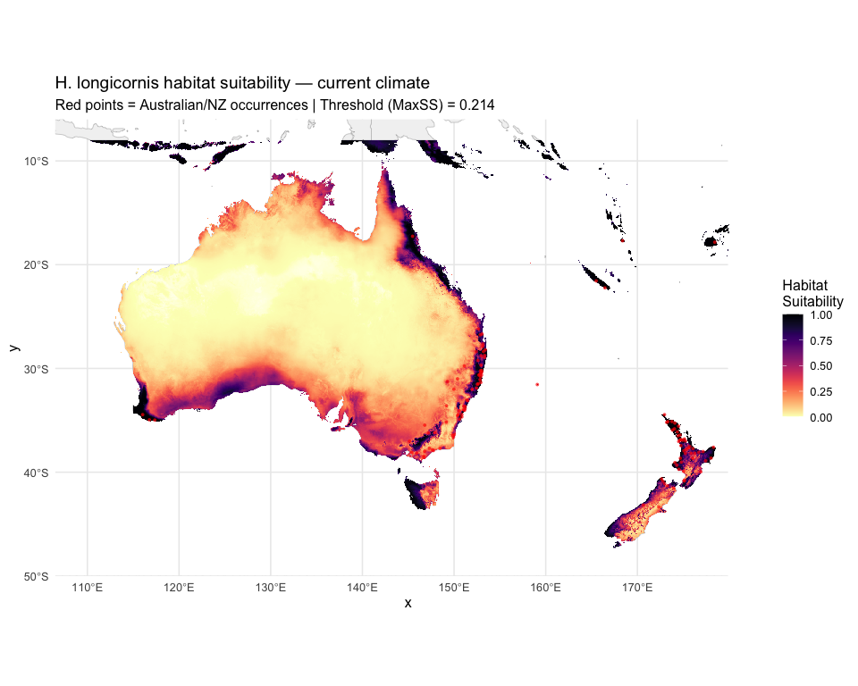
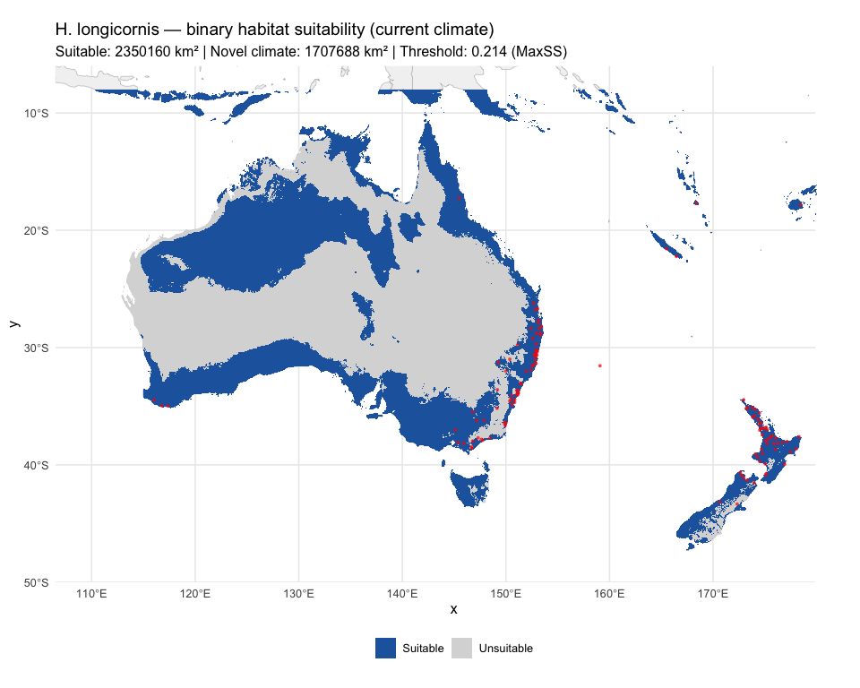

# Step 7: Current Prediction for Australia/NZ
Alexander W. Gofton
2026-02-21

- [Overview](#overview)
- [1. Load model, rasters, and
  threshold](#1-load-model-rasters-and-threshold)
- [2. Generate continuous suitability
  prediction](#2-generate-continuous-suitability-prediction)
- [3. Apply binary threshold and MESS
  masking](#3-apply-binary-threshold-and-mess-masking)
- [4. Maps](#4-maps)
- [5. Save outputs](#5-save-outputs)
- [Summary](#summary)
- [Session Information](#session-information)

## Overview

Project the optimized MaxEnt model to Australia and New Zealand under
current climate conditions. Key improvements over v1:

- **MESS masking** — areas with novel climate conditions (MESS \< 0) are
  masked on the binary map and cross-hatched on the continuous map.
- **Principled threshold** — binary suitable/unsuitable classification
  uses the Maximum Sensitivity + Specificity (MaxSS) threshold instead
  of 0.5.
- **Area calculations** — suitable habitat area computed from the binary
  map.

``` r
options(java.parameters = "-Xmx8g")

library(tidyverse)
library(terra)
library(sf)
library(rnaturalearth)
library(rnaturalearthdata)
library(predicts)
library(rJava)
library(viridis)
```

``` r
base_dir <- "~/Library/CloudStorage/OneDrive-CSIRO/OneDrive - Docs/01_Projects/Hlongicornis_SDM/"
processed_v2 <- file.path(base_dir, "processed_data_2")
figures_dir  <- file.path(base_dir, "figures_2")
outputs_dir  <- file.path(base_dir, "outputs_2")
```

## 1. Load model, rasters, and threshold

``` r
# Selected MaxEnt model
selected_model <- readRDS(file.path(processed_v2, "selected_maxent_model.rds"))

# Environmental rasters for Australia/NZ (selected variables only)
env_aus_nz <- rast(file.path(processed_v2, "env_selected_aus_nz.tif"))

# MESS raster (computed in Step 6)
mess_aus_nz <- rast(file.path(processed_v2, "mess_aus_nz.tif"))

# Primary threshold (MaxSS, computed in Step 6)
primary_threshold <- as.numeric(readLines(
  file.path(processed_v2, "primary_threshold.txt")
))

sprintf("Loaded model, env rasters (%d layers), and threshold (%.4f)",
        nlyr(env_aus_nz), primary_threshold)
```

    [1] "Loaded model, env rasters (5 layers), and threshold (0.2138)"

## 2. Generate continuous suitability prediction

``` r
# Project the model to Australia/NZ
pred_current <- predict(env_aus_nz, selected_model, type = "cloglog")
names(pred_current) <- "suitability"

# Summary statistics
suit_stats <- global(pred_current, fun = c("mean", "min", "max", "sd"),
                     na.rm = TRUE)

sprintf("Suitability range: %.4f to %.4f (mean = %.4f, SD = %.4f)",
        suit_stats$min, suit_stats$max, suit_stats$mean, suit_stats$sd)
```

    [1] "Suitability range: 0.0011 to 1.0000 (mean = 0.1912, SD = 0.2710)"

## 3. Apply binary threshold and MESS masking

``` r
# Binary prediction using MaxSS threshold
pred_binary <- pred_current >= primary_threshold
names(pred_binary) <- "suitable"

# MESS mask: identify cells with novel climate (MESS < 0)
mess_mask <- mess_aus_nz >= 0  # TRUE = analogous, FALSE = novel

# Binary prediction with MESS masking (novel areas set to NA)
pred_binary_masked <- mask(pred_binary, mess_mask, maskvalues = FALSE)
names(pred_binary_masked) <- "suitable_mess_masked"

# Count cells
cell_area_km2 <- prod(res(pred_binary)) * 111^2 * cos(mean(ext(pred_binary)[3:4]) * pi / 180)

n_suitable <- global(pred_binary, sum, na.rm = TRUE)[[1]]
n_suitable_masked <- global(pred_binary_masked, sum, na.rm = TRUE)[[1]]
n_novel <- global(!mess_mask, sum, na.rm = TRUE)[[1]]
n_total_land <- global(!is.na(pred_binary), sum)[[1]]

area_suitable <- n_suitable * cell_area_km2
area_suitable_masked <- n_suitable_masked * cell_area_km2
area_novel <- n_novel * cell_area_km2

sprintf("Suitable habitat (before MESS mask): %.0f km² (%.1f%% of land)",
        area_suitable, 100 * n_suitable / n_total_land)
sprintf("Suitable habitat (after MESS mask):  %.0f km² (%.1f%% of land)",
        area_suitable_masked, 100 * n_suitable_masked / n_total_land)
sprintf("Novel climate area (MESS < 0):       %.0f km² (%.1f%% of land)",
        area_novel, 100 * n_novel / n_total_land)
```

    [1] "Suitable habitat (before MESS mask): 2350160 km² (28.3% of land)"
    [1] "Suitable habitat (after MESS mask):  2146749 km² (25.9% of land)"
    [1] "Novel climate area (MESS < 0):       1707688 km² (20.6% of land)"

## 4. Maps

``` r
# Convert to data frame for ggplot
pred_df <- as.data.frame(pred_current, xy = TRUE) %>%
  filter(!is.na(suitability))

world_map <- ne_countries(scale = "medium", returnclass = "sf")

# Load occurrence points for overlay
occ <- read_csv(file.path(processed_v2, "occurrences_stratified.csv"),
                show_col_types = FALSE) %>%
  filter(region == "Oceania")  # Only Australian/NZ occurrences

ggplot() +
  geom_sf(data = world_map, fill = "grey95", colour = "grey70", linewidth = 0.2) +
  geom_raster(data = pred_df, aes(x = x, y = y, fill = suitability)) +
  scale_fill_gradientn(
    colours = c("white", magma(256, direction = -1)),
    limits = c(0, 1),
    name = "Habitat\nSuitability"
  ) +
  geom_point(data = occ, aes(x = lon, y = lat),
             colour = "red", size = 1, alpha = 0.7, shape = 16) +
  coord_sf(xlim = c(110, 180), ylim = c(-48, -8)) +
  labs(
    title = "H. longicornis habitat suitability — current climate",
    subtitle = sprintf("Red points = Australian/NZ occurrences | Threshold (MaxSS) = %.3f",
                       primary_threshold)
  ) +
  theme_minimal(base_size = 12)

ggsave(file.path(figures_dir, "07_current_suitability_continuous.png"),
       width = 10, height = 8, dpi = 300)
```

<div id="fig-continuous-suitability">



Figure 1: Continuous habitat suitability for H. longicornis under
current climate.

</div>

``` r
# Create a three-class raster: suitable, unsuitable, novel (MESS < 0)
# 0 = unsuitable, 1 = suitable, 2 = novel climate (unreliable)
pred_classified <- pred_binary
pred_classified[!mess_mask & !is.na(pred_binary)] <- 2

class_df <- as.data.frame(pred_classified, xy = TRUE) %>%
  filter(!is.na(suitable)) %>%
  mutate(
    category = case_when(
      suitable == 2 ~ "Novel climate (MESS < 0)",
      suitable == 1 ~ "Suitable",
      suitable == 0 ~ "Unsuitable"
    ),
    category = factor(category,
                      levels = c("Suitable", "Unsuitable", "Novel climate (MESS < 0)"))
  )

ggplot() +
  geom_sf(data = world_map, fill = "grey95", colour = "grey70", linewidth = 0.2) +
  geom_raster(data = class_df, aes(x = x, y = y, fill = category)) +
  scale_fill_manual(
    values = c(
      "Suitable" = "#2166AC",
      "Unsuitable" = "grey85",
      "Novel climate (MESS < 0)" = "#FFD700"
    ),
    name = NULL
  ) +
  geom_point(data = occ, aes(x = lon, y = lat),
             colour = "red", size = 1, alpha = 0.7, shape = 16) +
  coord_sf(xlim = c(110, 180), ylim = c(-48, -8)) +
  labs(
    title = "H. longicornis — binary habitat suitability (current climate)",
    subtitle = sprintf(
      "Suitable: %.0f km² | Novel climate: %.0f km² | Threshold: %.3f (MaxSS)",
      area_suitable, area_novel, primary_threshold
    )
  ) +
  theme_minimal(base_size = 12) +
  theme(legend.position = "bottom")

ggsave(file.path(figures_dir, "07_current_suitability_binary.png"),
       width = 10, height = 8, dpi = 300)
```

<div id="fig-binary-suitability">



Figure 2: Binary suitable/unsuitable habitat (MaxSS threshold) with MESS
masking.

</div>

## 5. Save outputs

``` r
# Save rasters
writeRaster(pred_current,
            file.path(processed_v2, "prediction_current_continuous.tif"),
            overwrite = TRUE)
writeRaster(pred_binary,
            file.path(processed_v2, "prediction_current_binary.tif"),
            overwrite = TRUE)
writeRaster(pred_binary_masked,
            file.path(processed_v2, "prediction_current_binary_mess_masked.tif"),
            overwrite = TRUE)

# Save area statistics
area_stats <- tibble(
  Measure = c(
    "Suitable habitat (before MESS mask)",
    "Suitable habitat (after MESS mask)",
    "Novel climate area (MESS < 0)",
    "Total land area (Aus/NZ extent)",
    "Threshold (MaxSS)"
  ),
  Value = c(
    sprintf("%.0f km²", area_suitable),
    sprintf("%.0f km²", area_suitable_masked),
    sprintf("%.0f km²", area_novel),
    sprintf("%.0f km²", n_total_land * cell_area_km2),
    sprintf("%.4f", primary_threshold)
  )
)

write_csv(area_stats, file.path(outputs_dir, "current_habitat_area_v2.csv"))

sprintf("Current prediction outputs saved")
```

    [1] "Current prediction outputs saved"

## Summary

``` r
area_stats
```

    # A tibble: 5 × 2
      Measure                             Value      
      <chr>                               <chr>      
    1 Suitable habitat (before MESS mask) 2350160 km²
    2 Suitable habitat (after MESS mask)  2146749 km²
    3 Novel climate area (MESS < 0)       1707688 km²
    4 Total land area (Aus/NZ extent)     8292949 km²
    5 Threshold (MaxSS)                   0.2138     

## Session Information

``` r
sessionInfo()
```

    R version 4.4.1 (2024-06-14)
    Platform: aarch64-apple-darwin20
    Running under: macOS 26.2

    Matrix products: default
    BLAS:   /Library/Frameworks/R.framework/Versions/4.4-arm64/Resources/lib/libRblas.0.dylib 
    LAPACK: /Library/Frameworks/R.framework/Versions/4.4-arm64/Resources/lib/libRlapack.dylib;  LAPACK version 3.12.0

    locale:
    [1] en_US.UTF-8/en_US.UTF-8/en_US.UTF-8/C/en_US.UTF-8/en_US.UTF-8

    time zone: Australia/Brisbane
    tzcode source: internal

    attached base packages:
    [1] stats     graphics  grDevices utils     datasets  methods   base     

    other attached packages:
     [1] viridis_0.6.5           viridisLite_0.4.2       rJava_1.0-11           
     [4] predicts_0.1-19         rnaturalearthdata_1.0.0 rnaturalearth_1.1.0    
     [7] sf_1.0-24               terra_1.8-93            lubridate_1.9.4        
    [10] forcats_1.0.0           stringr_1.6.0           dplyr_1.1.4            
    [13] purrr_1.1.0             readr_2.1.6             tidyr_1.3.1            
    [16] tibble_3.3.1            ggplot2_4.0.0           tidyverse_2.0.0        

    loaded via a namespace (and not attached):
     [1] gtable_0.3.6       xfun_0.53          tzdb_0.5.0         vctrs_0.7.1       
     [5] tools_4.4.1        generics_0.1.4     parallel_4.4.1     proxy_0.4-29      
     [9] pkgconfig_2.0.3    KernSmooth_2.23-26 RColorBrewer_1.1-3 S7_0.2.0          
    [13] lifecycle_1.0.5    compiler_4.4.1     farver_2.1.2       textshaping_1.0.3 
    [17] codetools_0.2-20   htmltools_0.5.8.1  class_7.3-23       yaml_2.3.10       
    [21] pillar_1.11.1      crayon_1.5.3       classInt_0.4-11    tidyselect_1.2.1  
    [25] digest_0.6.37      stringi_1.8.7      labeling_0.4.3     fastmap_1.2.0     
    [29] grid_4.4.1         cli_3.6.5          magrittr_2.0.4     utf8_1.2.6        
    [33] e1071_1.7-17       withr_3.0.2        scales_1.4.0       bit64_4.6.0-1     
    [37] timechange_0.3.0   rmarkdown_2.29     bit_4.6.0          gridExtra_2.3     
    [41] ragg_1.5.0         hms_1.1.4          evaluate_1.0.5     knitr_1.50        
    [45] rlang_1.1.7        Rcpp_1.1.1         glue_1.8.0         DBI_1.2.3         
    [49] vroom_1.7.0        jsonlite_2.0.0     R6_2.6.1           systemfonts_1.2.3 
    [53] units_1.0-0       
