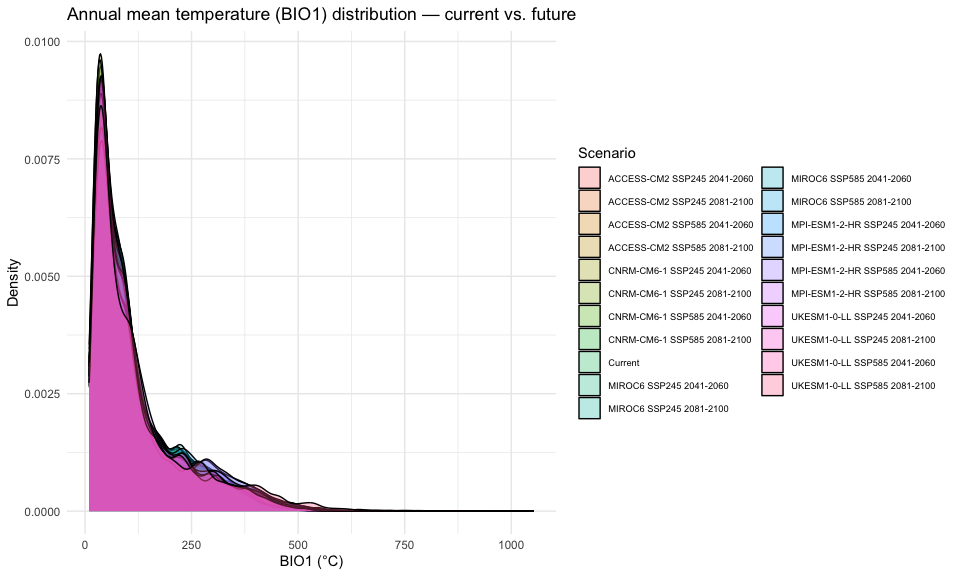

# Step 8: Future Climate Data
Alexander W. Gofton
2026-02-23

- [Overview](#overview)
- [1. Define scenario matrix](#1-define-scenario-matrix)
- [2. Load current climate data](#2-load-current-climate-data)
- [3. Download future WorldClim bioclimatic
  variables](#3-download-future-worldclim-bioclimatic-variables)
- [4. Compute future ENVIREM/CHELSA variables using delta-change
  method](#4-compute-future-enviremchelsa-variables-using-delta-change-method)
- [5. Verify all scenarios downloaded
  successfully](#5-verify-all-scenarios-downloaded-successfully)
- [6. Quick comparison of current vs. future
  climate](#6-quick-comparison-of-current-vs-future-climate)
- [7. Document temperature units](#7-document-temperature-units)
- [8. Save scenario metadata](#8-save-scenario-metadata)
- [Summary](#summary)
- [Session Information](#session-information)

## Overview

Download and prepare future climate data for 5 GCMs, 2 SSPs, and 2 time
periods (20 total future climate stacks). Key changes from v1:

- **5 GCMs** (was 3): MIROC6, MPI-ESM1-2-HR, UKESM1-0-LL + ACCESS-CM2
  and CNRM-CM6-1
- **Match all selected variables** including ENVIREM and CHELSA-derived
  layers (using delta-change method where future versions aren’t
  directly available)
- **Explicit temperature unit documentation**

**Scenario matrix:** 5 GCMs × 2 SSPs × 2 time periods = 20 stacks

**Note on ENVIREM/CHELSA future variables:** Direct future projections
for ENVIREM and CHELSA are not available for all GCMs. We use a
delta-change approach: compute the proportional change in the underlying
WorldClim variables between current and future, and apply that change to
the current ENVIREM/CHELSA values. This is a standard approach in SDM
studies (e.g., Raghavan et al. 2019).

``` r
library(tidyverse)
library(terra)
library(geodata)
```

``` r
base_dir <- "~/Library/CloudStorage/OneDrive-CSIRO/OneDrive - Docs/01_Projects/Hlongicornis_SDM/"
processed_v2 <- file.path(base_dir, "processed_data_2")
figures_dir  <- file.path(base_dir, "figures_2")
outputs_dir  <- file.path(base_dir, "outputs_2")
data_dir     <- file.path(base_dir, "data")
temp_dir     <- file.path(base_dir, "temp")

terraOptions(memfrac = 0.6, tempdir = temp_dir)
```

## 1. Define scenario matrix

``` r
# GCMs — 5 models spanning a range of climate sensitivities
gcms <- c(
  "MIROC6",          # Japanese model, moderate-high sensitivity
  "MPI-ESM1-2-HR",   # German model, moderate sensitivity
  "UKESM1-0-LL",     # UK model, high sensitivity
  "ACCESS-CM2",      # Australian model, good regional performance for Oceania
  "CNRM-CM6-1"       # French model, moderate sensitivity
)

# SSPs (Shared Socioeconomic Pathways)
ssps <- c("245", "585")
# SSP2-4.5: "middle of the road" — moderate emissions
# SSP5-8.5: "fossil-fuelled development" — high emissions

# Time periods
periods <- c("2041-2060", "2081-2100")

# Full scenario grid
scenarios <- expand_grid(
  gcm = gcms,
  ssp = ssps,
  period = periods
)

sprintf("Total future scenarios: %d", nrow(scenarios))
scenarios
```

    [1] "Total future scenarios: 20"
    # A tibble: 20 × 3
       gcm           ssp   period   
       <chr>         <chr> <chr>    
     1 MIROC6        245   2041-2060
     2 MIROC6        245   2081-2100
     3 MIROC6        585   2041-2060
     4 MIROC6        585   2081-2100
     5 MPI-ESM1-2-HR 245   2041-2060
     6 MPI-ESM1-2-HR 245   2081-2100
     7 MPI-ESM1-2-HR 585   2041-2060
     8 MPI-ESM1-2-HR 585   2081-2100
     9 UKESM1-0-LL   245   2041-2060
    10 UKESM1-0-LL   245   2081-2100
    11 UKESM1-0-LL   585   2041-2060
    12 UKESM1-0-LL   585   2081-2100
    13 ACCESS-CM2    245   2041-2060
    14 ACCESS-CM2    245   2081-2100
    15 ACCESS-CM2    585   2041-2060
    16 ACCESS-CM2    585   2081-2100
    17 CNRM-CM6-1    245   2041-2060
    18 CNRM-CM6-1    245   2081-2100
    19 CNRM-CM6-1    585   2041-2060
    20 CNRM-CM6-1    585   2081-2100

## 2. Load current climate data

We need the current WorldClim bioclimatic variables both for the final
selected variables and for computing the delta-change ratios for
ENVIREM/CHELSA layers.

``` r
# Current environmental stack (selected variables, Aus/NZ)
env_current <- rast(file.path(processed_v2, "env_selected_aus_nz.tif"))
selected_vars <- names(env_current)

sprintf("Selected variables for projection: %s",
        paste(selected_vars, collapse = ", "))

# Identify which variables come from each source
worldclim_vars <- selected_vars[grepl("^bio", selected_vars)]
envirem_vars   <- selected_vars[grepl("(cmi_idx|aridity_idx|pet_idx)", selected_vars)]
chelsa_vars    <- selected_vars[grepl("vpd_annual", selected_vars)]

sprintf("WorldClim: %s", paste(worldclim_vars, collapse = ", "))
sprintf("ENVIREM:   %s", paste(envirem_vars, collapse = ", "))
sprintf("CHELSA:    %s", paste(chelsa_vars, collapse = ", "))

# Load current WorldClim full global stack (for delta-change calculations)
# We need current bio12 (annual precip) and bio1 (mean temp) as baselines
# for scaling ENVIREM/CHELSA to future conditions
worldclim_path <- file.path(data_dir, "worldclim", "climate", "wc2.1_2.5m")
```

    [1] "Selected variables for projection: bio2, bio3, bio13, aridity_idx, vpd_annual"
    [1] "WorldClim: bio2, bio3, bio13"
    [1] "ENVIREM:   aridity_idx"
    [1] "CHELSA:    vpd_annual"

## 3. Download future WorldClim bioclimatic variables

Download future bioclimatic variables for all 20 scenarios. The geodata
package handles CMIP6 data from WorldClim.

``` r
# Directory for future climate data
future_dir <- file.path(data_dir, "future_climate")
dir.create(future_dir, showWarnings = FALSE, recursive = TRUE)

# Aus/NZ extent for cropping
aus_nz_ext <- ext(110, 180, -48, -8)

# Download and process each scenario
for (i in seq_len(nrow(scenarios))) {
  gcm    <- scenarios$gcm[i]
  ssp    <- scenarios$ssp[i]
  period <- scenarios$period[i]

  scenario_id <- sprintf("%s_ssp%s_%s", gcm, ssp, period)
  cache_file  <- file.path(future_dir, paste0(scenario_id, "_bioclim.tif"))

  if (file.exists(cache_file)) {
    message(sprintf("[%d/%d] %s — cached", i, nrow(scenarios), scenario_id))
    next
  }

  message(sprintf("[%d/%d] Downloading %s...", i, nrow(scenarios), scenario_id))

  tryCatch({
    # Download CMIP6 bioclimatic variables via geodata
    future_bio <- cmip6_world(
      model = gcm,
      ssp = ssp,
      time = period,
      var = "bioc",
      res = 2.5,
      path = file.path(data_dir, "worldclim")
    )

    # Rename layers to match our convention (bio1, bio2, ..., bio19)
    names(future_bio) <- paste0("bio", 1:nlyr(future_bio))

    # Crop to Aus/NZ
    future_bio_aus <- crop(future_bio, aus_nz_ext)

    # Save the cropped bioclim stack
    writeRaster(future_bio_aus, cache_file, overwrite = TRUE)

    message(sprintf("  Saved: %s (%d layers)", scenario_id, nlyr(future_bio_aus)))

  }, error = function(e) {
    message(sprintf("  ERROR downloading %s: %s", scenario_id, e$message))
  })
}
```

## 4. Compute future ENVIREM/CHELSA variables using delta-change method

For ENVIREM (CMI, aridity, PET) and CHELSA (VPD), we don’t have direct
future projections from each GCM. Instead, we compute relative changes
in the underlying climate variables and apply them to the current
ENVIREM/CHELSA values.

**Delta-change logic:**

- **PET** scales primarily with temperature:
  `PET_future = PET_current × (bio1_future / bio1_current)`
- **CMI** (moisture index) scales with precipitation relative to PET:
  `CMI_future = CMI_current × (bio12_future / bio12_current) / (bio1_future / bio1_current)`
  (simplified: more precip → higher CMI, more temp → lower CMI)
- **Aridity** is inversely related to moisture: apply inverse of CMI
  change
- **VPD** scales roughly with temperature (exponential relationship):
  `VPD_future = VPD_current × exp(0.06 × (bio1_future - bio1_current))`
  (Clausius-Clapeyron: ~6% increase per 1°C warming)

``` r
# Load current WorldClim bio1 and bio12 for Aus/NZ (for delta ratios)
bio1_current  <- rast(file.path(worldclim_path, "wc2.1_2.5m_bio_1.tif"))
bio12_current <- rast(file.path(worldclim_path, "wc2.1_2.5m_bio_12.tif"))
bio1_current  <- crop(bio1_current, aus_nz_ext)
bio12_current <- crop(bio12_current, aus_nz_ext)

# Load current ENVIREM/CHELSA layers for Aus/NZ
# These are already in the selected env stack
envirem_chelsa_current <- env_current[[c(envirem_vars, chelsa_vars)]]

# Process each scenario
for (i in seq_len(nrow(scenarios))) {
  gcm    <- scenarios$gcm[i]
  ssp    <- scenarios$ssp[i]
  period <- scenarios$period[i]

  scenario_id <- sprintf("%s_ssp%s_%s", gcm, ssp, period)
  output_file <- file.path(future_dir, paste0(scenario_id, "_all_selected.tif"))

  if (file.exists(output_file)) {
    message(sprintf("[%d/%d] %s — final stack cached", i, nrow(scenarios), scenario_id))
    next
  }

  # Load the future WorldClim bioclimatic variables
  bioclim_file <- file.path(future_dir, paste0(scenario_id, "_bioclim.tif"))
  if (!file.exists(bioclim_file)) {
    message(sprintf("  Skipping %s — bioclim file missing", scenario_id))
    next
  }

  future_bio <- rast(bioclim_file)

  # Extract selected WorldClim variables
  future_wc <- future_bio[[worldclim_vars]]

  # --- Delta-change for ENVIREM variables ---
  bio1_future  <- future_bio[["bio1"]]
  bio12_future <- future_bio[["bio12"]]

  # Temperature ratio (avoid division by zero with a small floor)
  temp_ratio <- bio1_future / max(bio1_current, 0.1)
  # Precipitation ratio
  precip_ratio <- bio12_future / max(bio12_current, 1)

  future_envirem_chelsa <- list()

  if ("pet_idx" %in% selected_vars) {
    # PET scales with temperature
    future_envirem_chelsa[["pet_idx"]] <-
      envirem_chelsa_current[["pet_idx"]] * abs(temp_ratio)
  }

  if ("cmi_idx" %in% selected_vars) {
    # CMI: moisture balance scales with precip/PET ratio
    future_envirem_chelsa[["cmi_idx"]] <-
      envirem_chelsa_current[["cmi_idx"]] * precip_ratio / max(abs(temp_ratio), 0.1)
  }

  if ("aridity_idx" %in% selected_vars) {
    # Aridity inversely related to moisture
    future_envirem_chelsa[["aridity_idx"]] <-
      envirem_chelsa_current[["aridity_idx"]] * abs(temp_ratio) / max(precip_ratio, 0.1)
  }

  if ("vpd_annual" %in% selected_vars) {
    # VPD follows Clausius-Clapeyron (~6% per °C)
    temp_change <- bio1_future - bio1_current
    future_envirem_chelsa[["vpd_annual"]] <-
      envirem_chelsa_current[["vpd_annual"]] * exp(0.06 * temp_change)
  }

  # Stack all future layers in the correct order
  future_stack <- future_wc

  for (var_name in c(envirem_vars, chelsa_vars)) {
    if (var_name %in% names(future_envirem_chelsa)) {
      future_stack <- c(future_stack, future_envirem_chelsa[[var_name]])
    }
  }

  # Verify layer names match selected variables
  names(future_stack) <- selected_vars

  # Ensure alignment with current env raster
  if (!compareGeom(future_stack, env_current, stopOnError = FALSE)) {
    future_stack <- resample(future_stack, env_current, method = "bilinear")
  }

  # Save
  writeRaster(future_stack, output_file, overwrite = TRUE)
  message(sprintf("[%d/%d] %s — saved (%d layers)",
                  i, nrow(scenarios), scenario_id, nlyr(future_stack)))
}
```

## 5. Verify all scenarios downloaded successfully

``` r
# Check which scenarios have complete data
download_status <- scenarios %>%
  mutate(
    scenario_id = sprintf("%s_ssp%s_%s", gcm, ssp, period),
    bioclim_file = file.path(future_dir, paste0(scenario_id, "_bioclim.tif")),
    final_file = file.path(future_dir, paste0(scenario_id, "_all_selected.tif")),
    bioclim_exists = file.exists(bioclim_file),
    final_exists = file.exists(final_file)
  )

sprintf("Scenarios with bioclim data: %d / %d",
        sum(download_status$bioclim_exists), nrow(download_status))
sprintf("Scenarios with complete stacks: %d / %d",
        sum(download_status$final_exists), nrow(download_status))

# Report any missing scenarios
missing <- download_status %>% filter(!final_exists)
if (nrow(missing) > 0) {
  message("WARNING: Missing scenario stacks:")
  print(missing %>% select(gcm, ssp, period))
}
```

    [1] "Scenarios with bioclim data: 20 / 20"
    [1] "Scenarios with complete stacks: 20 / 20"

## 6. Quick comparison of current vs. future climate

Verify that the future climate data shows expected warming and
precipitation changes relative to current conditions.

``` r
# Sample the current and future bio1 values across Aus/NZ
# Use the correct layer name from env_current
bio1_name <- worldclim_vars[grepl(
  "^bio.?1$|bio1",
  worldclim_vars,
  ignore.case = TRUE
)][1]

set.seed(7990)
sample_cells <- spatSample(
  env_current[[bio1_name]],
  size = 5000,
  method = "random",
  na.rm = TRUE,
  xy = TRUE
)
current_bio1 <- sample_cells[[bio1_name]]

# Sample future bio1 for each scenario
future_bio1_data <- list()
future_bio1_data[["Current"]] <- tibble(
  bio1 = current_bio1,
  scenario = "Current"
)

for (i in seq_len(nrow(scenarios))) {
  scenario_id <- sprintf(
    "%s_ssp%s_%s",
    scenarios$gcm[i],
    scenarios$ssp[i],
    scenarios$period[i]
  )
  final_file <- file.path(future_dir, paste0(scenario_id, "_all_selected.tif"))

  if (file.exists(final_file)) {
    future_stack <- rast(final_file)
    future_vals <- extract(
      future_stack[[bio1_name]],
      sample_cells[, c("x", "y")]
    )[[bio1_name]]
    future_bio1_data[[scenario_id]] <- tibble(
      bio1 = future_vals,
      scenario = sprintf(
        "%s SSP%s %s",
        scenarios$gcm[i],
        scenarios$ssp[i],
        scenarios$period[i]
      )
    )
  }
}

bio1_comparison <- bind_rows(future_bio1_data)

ggplot(bio1_comparison, aes(x = bio1, fill = scenario)) +
  geom_density(alpha = 0.3) +
  labs(
    title = "Annual mean temperature (BIO1) distribution — current vs. future",
    x = "BIO1 (°C)",
    y = "Density",
    fill = "Scenario"
  ) +
  theme_minimal(base_size = 11) +
  theme(legend.position = "right", legend.text = element_text(size = 7))

ggsave(
  file.path(figures_dir, "08_future_climate_comparison.png"),
  width = 10,
  height = 6,
  dpi = 300
)
```

<div id="fig-climate-comparison">



Figure 1: Distribution of BIO1 (annual mean temperature) across
scenarios for Australia/NZ.

</div>

## 7. Document temperature units

**WorldClim 2.1 temperature units:**

- Temperature variables (BIO1–BIO11) are in **degrees Celsius** (not
  ×10).
- This applies to both current and future (CMIP6) data from WorldClim
  2.1.
- WorldClim v1.4 stored temperature × 10 (as integers), but v2.1 uses
  floating point in actual °C.
- Precipitation variables (BIO12–BIO19) are in **millimetres**.

This is important for interpreting response curves and setting any
manual thresholds. A BIO1 value of 15 means 15°C (not 1.5°C).

## 8. Save scenario metadata

``` r
# Save the scenario grid for reference in Step 9
write_csv(scenarios, file.path(processed_v2, "future_scenarios.csv"))

# Save the file paths for each scenario
scenario_paths <- download_status %>%
  select(gcm, ssp, period, scenario_id, final_file, final_exists) %>%
  filter(final_exists)
write_csv(scenario_paths, file.path(processed_v2, "future_scenario_paths.csv"))

sprintf("Saved metadata for %d future climate scenarios", nrow(scenario_paths))
```

    [1] "Saved metadata for 20 future climate scenarios"

## Summary

``` r
tibble(
  Item = c(
    "GCMs",
    "SSPs",
    "Time periods",
    "Total scenarios",
    "Successfully prepared",
    "WorldClim variables",
    "Delta-change variables",
    "Resolution"
  ),
  Details = c(
    paste(gcms, collapse = ", "),
    "SSP2-4.5, SSP5-8.5",
    "2041-2060, 2081-2100",
    as.character(nrow(scenarios)),
    as.character(sum(download_status$final_exists)),
    paste(worldclim_vars, collapse = ", "),
    paste(c(envirem_vars, chelsa_vars), collapse = ", "),
    "2.5 arcmin (~5 km)"
  )
)
```

    # A tibble: 8 × 2
      Item                   Details                                                
      <chr>                  <chr>                                                  
    1 GCMs                   MIROC6, MPI-ESM1-2-HR, UKESM1-0-LL, ACCESS-CM2, CNRM-C…
    2 SSPs                   SSP2-4.5, SSP5-8.5                                     
    3 Time periods           2041-2060, 2081-2100                                   
    4 Total scenarios        20                                                     
    5 Successfully prepared  20                                                     
    6 WorldClim variables    bio2, bio3, bio13                                      
    7 Delta-change variables aridity_idx, vpd_annual                                
    8 Resolution             2.5 arcmin (~5 km)                                     

## Session Information

``` r
sessionInfo()
```

    R version 4.4.1 (2024-06-14)
    Platform: aarch64-apple-darwin20
    Running under: macOS 26.2

    Matrix products: default
    BLAS:   /Library/Frameworks/R.framework/Versions/4.4-arm64/Resources/lib/libRblas.0.dylib 
    LAPACK: /Library/Frameworks/R.framework/Versions/4.4-arm64/Resources/lib/libRlapack.dylib;  LAPACK version 3.12.0

    locale:
    [1] en_US.UTF-8/en_US.UTF-8/en_US.UTF-8/C/en_US.UTF-8/en_US.UTF-8

    time zone: Australia/Brisbane
    tzcode source: internal

    attached base packages:
    [1] stats     graphics  grDevices utils     datasets  methods   base     

    other attached packages:
     [1] geodata_0.6-2   terra_1.8-93    lubridate_1.9.4 forcats_1.0.0  
     [5] stringr_1.6.0   dplyr_1.1.4     purrr_1.1.0     readr_2.1.6    
     [9] tidyr_1.3.1     tibble_3.3.1    ggplot2_4.0.0   tidyverse_2.0.0

    loaded via a namespace (and not attached):
     [1] utf8_1.2.6         generics_0.1.4     stringi_1.8.7      hms_1.1.4         
     [5] digest_0.6.37      magrittr_2.0.4     evaluate_1.0.5     grid_4.4.1        
     [9] timechange_0.3.0   RColorBrewer_1.1-3 fastmap_1.2.0      jsonlite_2.0.0    
    [13] scales_1.4.0       codetools_0.2-20   textshaping_1.0.3  cli_3.6.5         
    [17] rlang_1.1.7        crayon_1.5.3       bit64_4.6.0-1      withr_3.0.2       
    [21] yaml_2.3.10        parallel_4.4.1     tools_4.4.1        tzdb_0.5.0        
    [25] vctrs_0.7.1        R6_2.6.1           lifecycle_1.0.5    bit_4.6.0         
    [29] vroom_1.7.0        ragg_1.5.0         pkgconfig_2.0.3    pillar_1.11.1     
    [33] gtable_0.3.6       glue_1.8.0         Rcpp_1.1.1         systemfonts_1.2.3 
    [37] xfun_0.53          tidyselect_1.2.1   knitr_1.50         farver_2.1.2      
    [41] htmltools_0.5.8.1  rmarkdown_2.29     labeling_0.4.3     compiler_4.4.1    
    [45] S7_0.2.0          
