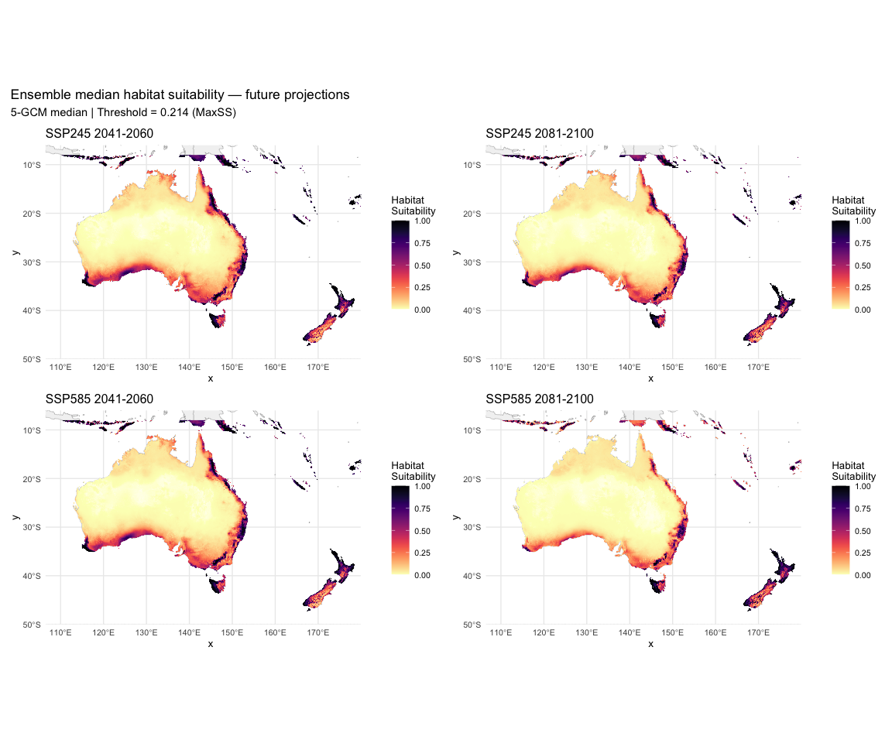
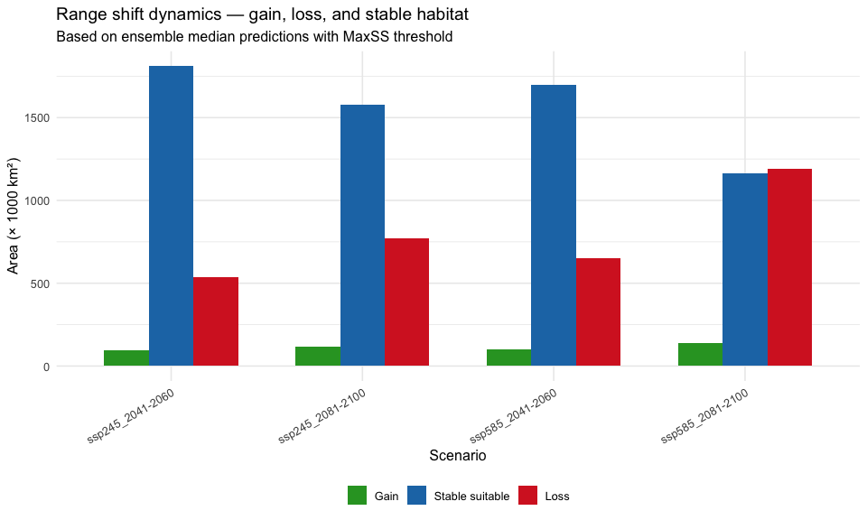
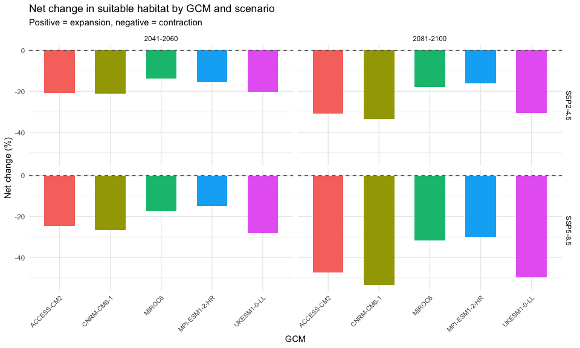

# Step 9: Future Projections
Alexander W. Gofton
2026-02-23

- [Overview](#overview)
- [1. Load model, current prediction, and scenario
  metadata](#1-load-model-current-prediction-and-scenario-metadata)
- [2. Project model to all future
  scenarios](#2-project-model-to-all-future-scenarios)
- [3. Compute ensemble statistics for each SSP × period
  combination](#3-compute-ensemble-statistics-for-each-ssp--period-combination)
- [4. Range shift dynamics — gain, loss,
  stable](#4-range-shift-dynamics--gain-loss-stable)
- [5. Per-GCM results](#5-per-gcm-results)
- [6. Ensemble summary with
  uncertainty](#6-ensemble-summary-with-uncertainty)
- [7. Visualise ensemble projections](#7-visualise-ensemble-projections)
- [8. Save outputs](#8-save-outputs)
- [Summary](#summary)
- [Session Information](#session-information)

## Overview

Project the optimized MaxEnt model to all 20 future climate scenarios
and compute ensemble statistics. Key improvements over v1:

- **MESS masking on all projections** — novel climate regions masked
- **Median ensemble** (not mean) as the primary statistic — robust to
  outliers like the MIROC6 SSP2-4.5 issue from v1
- **Range shift dynamics** — gain, loss, and stable area calculated (not
  just net change)
- **Per-GCM individual results** alongside ensemble statistics
- **No dispersal constraints** — per user decision (open pastoral
  landscape)

``` r
options(java.parameters = "-Xmx8g")

library(tidyverse)
library(terra)
library(sf)
library(predicts)
library(rJava)
library(rnaturalearth)
library(rnaturalearthdata)
library(viridis)
```

``` r
base_dir <- "~/Library/CloudStorage/OneDrive-CSIRO/OneDrive - Docs/01_Projects/Hlongicornis_SDM/"
processed_v2 <- file.path(base_dir, "processed_data_2")
figures_dir  <- file.path(base_dir, "figures_2")
outputs_dir  <- file.path(base_dir, "outputs_2")
future_dir   <- file.path(base_dir, "data", "future_climate")
```

## 1. Load model, current prediction, and scenario metadata

``` r
# Selected MaxEnt model
selected_model <- readRDS(file.path(processed_v2, "selected_maxent_model.rds"))

# Current climate rasters and prediction
env_current <- rast(file.path(processed_v2, "env_selected_aus_nz.tif"))
pred_current <- rast(file.path(processed_v2, "prediction_current_continuous.tif"))
pred_binary_current <- rast(file.path(processed_v2, "prediction_current_binary.tif"))

# MESS from current (for reference)
mess_current <- rast(file.path(processed_v2, "mess_aus_nz.tif"))

# Threshold
primary_threshold <- as.numeric(readLines(
  file.path(processed_v2, "primary_threshold.txt")
))

# Scenario metadata
scenarios <- read_csv(file.path(processed_v2, "future_scenarios.csv"),
                      show_col_types = FALSE)
scenario_paths <- read_csv(file.path(processed_v2, "future_scenario_paths.csv"),
                           show_col_types = FALSE)

# Training environment (for MESS calculations)
occ_coords <- read_csv(file.path(processed_v2, "occurrence_coords.csv"),
                       show_col_types = FALSE)
bg_points  <- read_csv(file.path(processed_v2, "background_points.csv"),
                       show_col_types = FALSE)
env_M <- readRDS(file.path(processed_v2, "env_selected_M.rds"))

selected_vars <- names(env_current)
training_env <- bind_rows(
  extract(env_M, as.matrix(occ_coords[, c("lon", "lat")])) |> as_tibble(),
  bg_points |> select(all_of(selected_vars))
) |>
  drop_na() |>
  as.data.frame()

sprintf("Scenarios to project: %d", nrow(scenario_paths))
sprintf("Threshold (MaxSS): %.4f", primary_threshold)
```

    [1] "Scenarios to project: 20"
    [1] "Threshold (MaxSS): 0.2138"

## 2. Project model to all future scenarios

For each scenario, generate: - Continuous suitability prediction - MESS
surface - Binary prediction (with MESS mask)

``` r
# Store results in lists
predictions <- list()
mess_surfaces <- list()
binary_preds <- list()

for (i in seq_len(nrow(scenario_paths))) {
  sid <- scenario_paths$scenario_id[i]
  message(sprintf("[%d/%d] Projecting %s...", i, nrow(scenario_paths), sid))

  # Load future climate stack
  future_env <- rast(scenario_paths$final_file[i])

  # Ensure layer names match
  names(future_env) <- selected_vars

  # Predict suitability
  pred <- predict(future_env, selected_model, type = "cloglog")
  names(pred) <- "suitability"

  # Compute MESS relative to training environment
  mess_future <- mess(future_env, training_env, full = FALSE)
  names(mess_future) <- "mess"

  # Binary prediction with MESS mask
  pred_bin <- pred >= primary_threshold
  mess_mask <- mess_future >= 0
  pred_bin_masked <- mask(pred_bin, mess_mask, maskvalues = FALSE)

  # Store
  predictions[[sid]] <- pred
  mess_surfaces[[sid]] <- mess_future
  binary_preds[[sid]] <- pred_bin_masked

  # Save individual rasters
  writeRaster(pred,
              file.path(processed_v2, paste0("pred_future_", sid, ".tif")),
              overwrite = TRUE)
}

sprintf("Projected %d scenarios successfully", length(predictions))
```

    [1] "Projected 20 scenarios successfully"

## 3. Compute ensemble statistics for each SSP × period combination

For each of the 4 SSP × period combinations, compute median, mean, SD,
and range across the 5 GCMs.

``` r
# Define the 4 scenario groups
ssp_periods <- expand_grid(
  ssp = c("245", "585"),
  period = c("2041-2060", "2081-2100")
)

ensemble_results <- list()

for (j in seq_len(nrow(ssp_periods))) {
  ssp_j    <- ssp_periods$ssp[j]
  period_j <- ssp_periods$period[j]
  group_id <- sprintf("ssp%s_%s", ssp_j, period_j)

  # Find all scenarios matching this SSP × period
  matching <- scenario_paths %>%
    filter(ssp == ssp_j, period == period_j)

  if (nrow(matching) == 0) next

  # Stack all GCM predictions for this group
  pred_stack <- rast(lapply(matching$scenario_id, function(sid) predictions[[sid]]))

  # Compute ensemble statistics
  ens_median <- app(pred_stack, fun = "median", na.rm = TRUE)
  ens_mean   <- app(pred_stack, fun = "mean", na.rm = TRUE)
  ens_sd     <- app(pred_stack, fun = "sd", na.rm = TRUE)
  ens_min    <- app(pred_stack, fun = "min", na.rm = TRUE)
  ens_max    <- app(pred_stack, fun = "max", na.rm = TRUE)

  names(ens_median) <- "median"
  names(ens_mean)   <- "mean"
  names(ens_sd)     <- "sd"
  names(ens_min)    <- "min"
  names(ens_max)    <- "max"

  # Binary from median prediction
  ens_binary <- ens_median >= primary_threshold

  # Save ensemble rasters
  ens_stack <- c(ens_median, ens_mean, ens_sd, ens_min, ens_max)
  writeRaster(ens_stack,
              file.path(processed_v2, paste0("ensemble_", group_id, ".tif")),
              overwrite = TRUE)

  ensemble_results[[group_id]] <- list(
    median = ens_median,
    mean = ens_mean,
    sd = ens_sd,
    binary = ens_binary,
    n_gcms = nrow(matching)
  )

  sprintf("Ensemble %s: %d GCMs stacked", group_id, nrow(matching))
}
```

## 4. Range shift dynamics — gain, loss, stable

For each future scenario, classify every cell into: - **Stable
suitable** — suitable in both current and future - **Gain** — unsuitable
now, suitable in future - **Loss** — suitable now, unsuitable in
future - **Stable unsuitable** — unsuitable in both

``` r
# Current binary (unmasked for shift calculations)
current_binary <- pred_current >= primary_threshold

shift_results <- list()

for (group_id in names(ensemble_results)) {
  future_binary <- ensemble_results[[group_id]]$binary

  # Classify cells
  # current = 1, future = 1 → stable suitable (value = 3)
  # current = 0, future = 1 → gain (value = 2)
  # current = 1, future = 0 → loss (value = 1)
  # current = 0, future = 0 → stable unsuitable (value = 0)
  shift_rast <- current_binary * 2 + future_binary
  # Recode: 3 = stable suitable, 2 = loss, 1 = gain, 0 = stable unsuitable
  # Actually: current*2 + future gives:
  #   1*2 + 1 = 3 → stable suitable
  #   1*2 + 0 = 2 → loss
  #   0*2 + 1 = 1 → gain
  #   0*2 + 0 = 0 → stable unsuitable

  names(shift_rast) <- "shift_class"

  # Calculate areas
  cell_area_km2 <- prod(res(current_binary)) * 111^2 *
    cos(mean(ext(current_binary)[3:4]) * pi / 180)

  n_stable_suit  <- global(shift_rast == 3, sum, na.rm = TRUE)[[1]]
  n_gain         <- global(shift_rast == 1, sum, na.rm = TRUE)[[1]]
  n_loss         <- global(shift_rast == 2, sum, na.rm = TRUE)[[1]]
  n_stable_unsuit <- global(shift_rast == 0, sum, na.rm = TRUE)[[1]]

  shift_results[[group_id]] <- tibble(
    scenario = group_id,
    stable_suitable_km2 = n_stable_suit * cell_area_km2,
    gain_km2 = n_gain * cell_area_km2,
    loss_km2 = n_loss * cell_area_km2,
    stable_unsuitable_km2 = n_stable_unsuit * cell_area_km2,
    net_change_km2 = (n_gain - n_loss) * cell_area_km2,
    current_suitable_km2 = (n_stable_suit + n_loss) * cell_area_km2,
    future_suitable_km2 = (n_stable_suit + n_gain) * cell_area_km2,
    pct_change = round(100 * (n_gain - n_loss) / (n_stable_suit + n_loss), 1)
  )

  # Save shift raster
  writeRaster(shift_rast,
              file.path(processed_v2, paste0("range_shift_", group_id, ".tif")),
              overwrite = TRUE)
}

shift_table <- bind_rows(shift_results)
shift_table
```

    # A tibble: 4 × 9
      scenario         stable_suitable_km2 gain_km2 loss_km2 stable_unsuitable_km2
      <chr>                          <dbl>    <dbl>    <dbl>                 <dbl>
    1 ssp245_2041-2060            1811471.   96342.  538689.              5846447.
    2 ssp245_2081-2100            1579371.  114945.  770789.              5827843.
    3 ssp585_2041-2060            1698226.  100138.  651935.              5842651.
    4 ssp585_2081-2100            1161954.  137213. 1188206.              5805576.
    # ℹ 4 more variables: net_change_km2 <dbl>, current_suitable_km2 <dbl>,
    #   future_suitable_km2 <dbl>, pct_change <dbl>

## 5. Per-GCM results

``` r
# For each individual scenario, compute suitable area and net change
gcm_results <- list()

for (i in seq_len(nrow(scenario_paths))) {
  sid <- scenario_paths$scenario_id[i]

  future_binary <- predictions[[sid]] >= primary_threshold
  shift <- current_binary * 2 + future_binary

  cell_area_km2 <- prod(res(current_binary)) * 111^2 *
    cos(mean(ext(current_binary)[3:4]) * pi / 180)

  n_gain <- global(shift == 1, sum, na.rm = TRUE)[[1]]
  n_loss <- global(shift == 2, sum, na.rm = TRUE)[[1]]
  n_stable <- global(shift == 3, sum, na.rm = TRUE)[[1]]
  n_current <- n_stable + n_loss

  # MESS extrapolation for this scenario
  n_novel <- global(mess_surfaces[[sid]] < 0, sum, na.rm = TRUE)[[1]]
  n_valid <- global(!is.na(mess_surfaces[[sid]]), sum)[[1]]

  gcm_results[[sid]] <- tibble(
    scenario_id = sid,
    gcm = scenario_paths$gcm[i],
    ssp = scenario_paths$ssp[i],
    period = scenario_paths$period[i],
    current_suitable_km2 = n_current * cell_area_km2,
    future_suitable_km2 = (n_stable + n_gain) * cell_area_km2,
    gain_km2 = n_gain * cell_area_km2,
    loss_km2 = n_loss * cell_area_km2,
    net_change_km2 = (n_gain - n_loss) * cell_area_km2,
    pct_change = round(100 * (n_gain - n_loss) / max(n_current, 1), 1),
    pct_extrapolation = round(100 * n_novel / max(n_valid, 1), 1)
  )
}

gcm_table <- bind_rows(gcm_results) %>%
  arrange(ssp, period, gcm)

gcm_table
```

    # A tibble: 20 × 11
       scenario_id       gcm     ssp period current_suitable_km2 future_suitable_km2
       <chr>             <chr> <dbl> <chr>                 <dbl>               <dbl>
     1 ACCESS-CM2_ssp24… ACCE…   245 2041-…             2350160.            1861238.
     2 CNRM-CM6-1_ssp24… CNRM…   245 2041-…             2350160.            1851284.
     3 MIROC6_ssp245_20… MIRO…   245 2041-…             2350160.            2029651.
     4 MPI-ESM1-2-HR_ss… MPI-…   245 2041-…             2350160.            1986646.
     5 UKESM1-0-LL_ssp2… UKES…   245 2041-…             2350160.            1875157.
     6 ACCESS-CM2_ssp24… ACCE…   245 2081-…             2350160.            1626626.
     7 CNRM-CM6-1_ssp24… CNRM…   245 2081-…             2350160.            1562543.
     8 MIROC6_ssp245_20… MIRO…   245 2081-…             2350160.            1930156.
     9 MPI-ESM1-2-HR_ss… MPI-…   245 2081-…             2350160.            1974294.
    10 UKESM1-0-LL_ssp2… UKES…   245 2081-…             2350160.            1634407.
    11 ACCESS-CM2_ssp58… ACCE…   585 2041-…             2350160.            1772866.
    12 CNRM-CM6-1_ssp58… CNRM…   585 2041-…             2350160.            1721079.
    13 MIROC6_ssp585_20… MIRO…   585 2041-…             2350160.            1948136.
    14 MPI-ESM1-2-HR_ss… MPI-…   585 2041-…             2350160.            1997525.
    15 UKESM1-0-LL_ssp5… UKES…   585 2041-…             2350160.            1690595.
    16 ACCESS-CM2_ssp58… ACCE…   585 2081-…             2350160.            1237652.
    17 CNRM-CM6-1_ssp58… CNRM…   585 2081-…             2350160.            1089447.
    18 MIROC6_ssp585_20… MIRO…   585 2081-…             2350160.            1603962.
    19 MPI-ESM1-2-HR_ss… MPI-…   585 2081-…             2350160.            1646891.
    20 UKESM1-0-LL_ssp5… UKES…   585 2081-…             2350160.            1179027.
    # ℹ 5 more variables: gain_km2 <dbl>, loss_km2 <dbl>, net_change_km2 <dbl>,
    #   pct_change <dbl>, pct_extrapolation <dbl>

## 6. Ensemble summary with uncertainty

``` r
# Summarise per-GCM results by SSP × period
uncertainty_summary <- gcm_table %>%
  group_by(ssp, period) %>%
  summarise(
    n_gcms = n(),
    median_net_change_km2 = median(net_change_km2),
    mean_net_change_km2 = mean(net_change_km2),
    sd_net_change_km2 = sd(net_change_km2),
    min_net_change_km2 = min(net_change_km2),
    max_net_change_km2 = max(net_change_km2),
    median_pct_change = median(pct_change),
    range_pct_change = sprintf("%.1f to %.1f%%", min(pct_change), max(pct_change)),
    median_extrapolation = median(pct_extrapolation),
    .groups = "drop"
  )

uncertainty_summary
```

    # A tibble: 4 × 11
        ssp period    n_gcms median_net_change_km2 mean_net_change_km2
      <dbl> <chr>      <int>                 <dbl>               <dbl>
    1   245 2041-2060      5              -475003.            -429365.
    2   245 2081-2100      5              -715753.            -604555.
    3   585 2041-2060      5              -577294.            -524120.
    4   585 2081-2100      5             -1112508.            -998764.
    # ℹ 6 more variables: sd_net_change_km2 <dbl>, min_net_change_km2 <dbl>,
    #   max_net_change_km2 <dbl>, median_pct_change <dbl>, range_pct_change <chr>,
    #   median_extrapolation <dbl>

## 7. Visualise ensemble projections

``` r
world_map <- ne_countries(scale = "medium", returnclass = "sf")

# Create maps for each scenario group
plot_list <- list()

for (group_id in names(ensemble_results)) {
  median_df <- as.data.frame(ensemble_results[[group_id]]$median, xy = TRUE) %>%
    filter(!is.na(median))

  p <- ggplot() +
    geom_sf(data = world_map, fill = "grey95", colour = "grey70", linewidth = 0.2) +
    geom_raster(data = median_df, aes(x = x, y = y, fill = median)) +
    scale_fill_gradientn(
        colours = c("white", magma(256, direction = -1)),
        limits = c(0, 1),
        name = "Habitat\nSuitability"
      ) +
    coord_sf(xlim = c(110, 180), ylim = c(-48, -8)) +
    labs(title = gsub("_", " ", toupper(group_id))) +
    theme_minimal(base_size = 10) +
    theme(legend.position = "right")

  plot_list[[group_id]] <- p
}

library(patchwork)
wrap_plots(plot_list, ncol = 2) +
  plot_annotation(
    title = "Ensemble median habitat suitability — future projections",
    subtitle = sprintf("5-GCM median | Threshold = %.3f (MaxSS)", primary_threshold)
  )

ggsave(file.path(figures_dir, "09_ensemble_suitability_maps.png"),
       width = 12, height = 10, dpi = 300)
```

<div id="fig-ensemble-maps">



Figure 1: Ensemble median habitat suitability under four future
scenarios.

</div>

``` r
shift_long <- shift_table %>%
  select(scenario, stable_suitable_km2, gain_km2, loss_km2) %>%
  pivot_longer(-scenario, names_to = "category", values_to = "area_km2") %>%
  mutate(
    category = case_when(
      category == "stable_suitable_km2" ~ "Stable suitable",
      category == "gain_km2" ~ "Gain",
      category == "loss_km2" ~ "Loss"
    ),
    category = factor(category, levels = c("Gain", "Stable suitable", "Loss"))
  )

ggplot(shift_long, aes(x = scenario, y = area_km2 / 1000, fill = category)) +
  geom_col(position = "dodge", width = 0.7) +
  scale_fill_manual(values = c(
    "Gain" = "#2ca02c",
    "Stable suitable" = "#1f77b4",
    "Loss" = "#d62728"
  )) +
  labs(
    title = "Range shift dynamics — gain, loss, and stable habitat",
    subtitle = "Based on ensemble median predictions with MaxSS threshold",
    x = "Scenario", y = "Area (× 1000 km²)", fill = NULL
  ) +
  theme_minimal(base_size = 12) +
  theme(legend.position = "bottom", axis.text.x = element_text(angle = 30, hjust = 1))

ggsave(file.path(figures_dir, "09_range_shift_dynamics.png"),
       width = 10, height = 6, dpi = 300)
```

<div id="fig-range-shift-bars">



Figure 2: Range shift dynamics (gain, loss, stable) across scenarios.

</div>

``` r
ggplot(gcm_table, aes(x = gcm, y = pct_change, fill = gcm)) +
  geom_col(width = 0.6) +
  facet_grid(ssp ~ period, labeller = labeller(
    ssp = c("245" = "SSP2-4.5", "585" = "SSP5-8.5")
  )) +
  geom_hline(yintercept = 0, linetype = "dashed", colour = "grey40") +
  labs(
    title = "Net change in suitable habitat by GCM and scenario",
    subtitle = "Positive = expansion, negative = contraction",
    x = "GCM", y = "Net change (%)", fill = "GCM"
  ) +
  theme_minimal(base_size = 11) +
  theme(
    axis.text.x = element_text(angle = 45, hjust = 1, size = 8),
    legend.position = "none"
  )

ggsave(file.path(figures_dir, "09_gcm_variability.png"),
       width = 10, height = 6, dpi = 300)
```

<div id="fig-gcm-variability">



Figure 3: Per-GCM net change in suitable habitat area, showing
inter-model uncertainty.

</div>

## 8. Save outputs

``` r
# Save range shift summary tables
write_csv(shift_table, file.path(outputs_dir, "range_shift_summary_v2.csv"))
write_csv(gcm_table, file.path(outputs_dir, "per_gcm_results_v2.csv"))
write_csv(uncertainty_summary, file.path(outputs_dir, "ensemble_uncertainty_v2.csv"))

sprintf("Future projection outputs saved to %s", outputs_dir)
```

    [1] "Future projection outputs saved to ~/Library/CloudStorage/OneDrive-CSIRO/OneDrive - Docs/01_Projects/Hlongicornis_SDM//outputs_2"

## Summary

``` r
# High-level summary
shift_table %>%
  select(scenario, current_suitable_km2, future_suitable_km2,
         gain_km2, loss_km2, net_change_km2, pct_change) %>%
  mutate(across(where(is.numeric), ~ round(., 0)))
```

    # A tibble: 4 × 7
      scenario         current_suitable_km2 future_suitable_km2 gain_km2 loss_km2
      <chr>                           <dbl>               <dbl>    <dbl>    <dbl>
    1 ssp245_2041-2060              2350160             1907812    96342   538689
    2 ssp245_2081-2100              2350160             1694316   114945   770789
    3 ssp585_2041-2060              2350160             1798363   100138   651935
    4 ssp585_2081-2100              2350160             1299166   137213  1188206
    # ℹ 2 more variables: net_change_km2 <dbl>, pct_change <dbl>

``` r
# Uncertainty overview
uncertainty_summary %>%
  select(ssp, period, median_pct_change, range_pct_change, median_extrapolation)
```

    # A tibble: 4 × 5
        ssp period    median_pct_change range_pct_change median_extrapolation
      <dbl> <chr>                 <dbl> <chr>                           <dbl>
    1   245 2041-2060             -20.2 -21.2 to -13.6%                  60.2
    2   245 2081-2100             -30.5 -33.5 to -16.0%                  70.9
    3   585 2041-2060             -24.6 -28.1 to -15.0%                  62.9
    4   585 2081-2100             -47.3 -53.6 to -29.9%                  80.8

## Session Information

``` r
sessionInfo()
```

    R version 4.4.1 (2024-06-14)
    Platform: aarch64-apple-darwin20
    Running under: macOS 26.2

    Matrix products: default
    BLAS:   /Library/Frameworks/R.framework/Versions/4.4-arm64/Resources/lib/libRblas.0.dylib 
    LAPACK: /Library/Frameworks/R.framework/Versions/4.4-arm64/Resources/lib/libRlapack.dylib;  LAPACK version 3.12.0

    locale:
    [1] C.UTF-8/C.UTF-8/C.UTF-8/C/C.UTF-8/C.UTF-8

    time zone: Australia/Brisbane
    tzcode source: internal

    attached base packages:
    [1] stats     graphics  grDevices utils     datasets  methods   base     

    other attached packages:
     [1] patchwork_1.3.2         viridis_0.6.5           viridisLite_0.4.2      
     [4] rnaturalearthdata_1.0.0 rnaturalearth_1.1.0     rJava_1.0-11           
     [7] predicts_0.1-19         sf_1.0-24               terra_1.8-93           
    [10] lubridate_1.9.4         forcats_1.0.0           stringr_1.6.0          
    [13] dplyr_1.1.4             purrr_1.1.0             readr_2.1.6            
    [16] tidyr_1.3.1             tibble_3.3.1            ggplot2_4.0.0          
    [19] tidyverse_2.0.0        

    loaded via a namespace (and not attached):
     [1] gtable_0.3.6       xfun_0.53          tzdb_0.5.0         vctrs_0.7.1       
     [5] tools_4.4.1        generics_0.1.4     parallel_4.4.1     proxy_0.4-29      
     [9] pkgconfig_2.0.3    KernSmooth_2.23-26 RColorBrewer_1.1-3 S7_0.2.0          
    [13] lifecycle_1.0.5    compiler_4.4.1     farver_2.1.2       textshaping_1.0.3 
    [17] codetools_0.2-20   htmltools_0.5.8.1  class_7.3-23       yaml_2.3.10       
    [21] pillar_1.11.1      crayon_1.5.3       classInt_0.4-11    tidyselect_1.2.1  
    [25] digest_0.6.37      stringi_1.8.7      labeling_0.4.3     fastmap_1.2.0     
    [29] grid_4.4.1         cli_3.6.5          magrittr_2.0.4     utf8_1.2.6        
    [33] e1071_1.7-17       withr_3.0.2        scales_1.4.0       bit64_4.6.0-1     
    [37] timechange_0.3.0   rmarkdown_2.29     bit_4.6.0          gridExtra_2.3     
    [41] ragg_1.5.0         hms_1.1.4          evaluate_1.0.5     knitr_1.50        
    [45] rlang_1.1.7        Rcpp_1.1.1         glue_1.8.0         DBI_1.2.3         
    [49] vroom_1.7.0        jsonlite_2.0.0     R6_2.6.1           systemfonts_1.2.3 
    [53] units_1.0-0       
