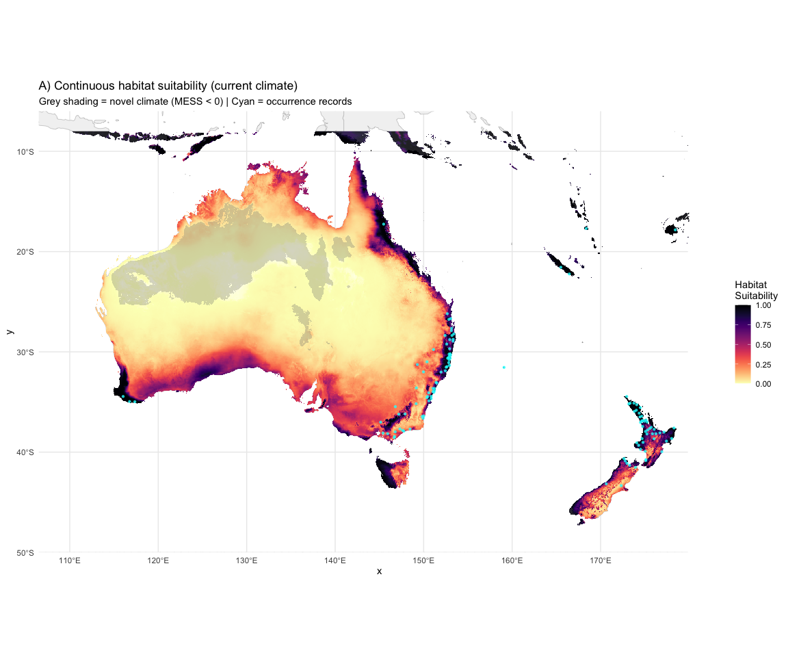
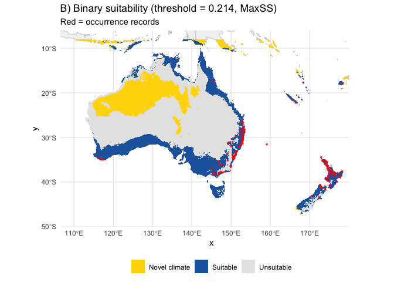
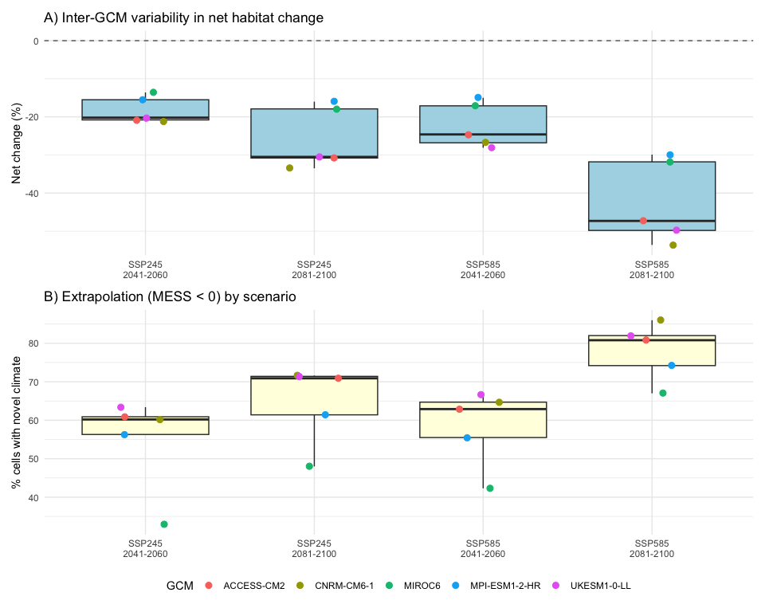
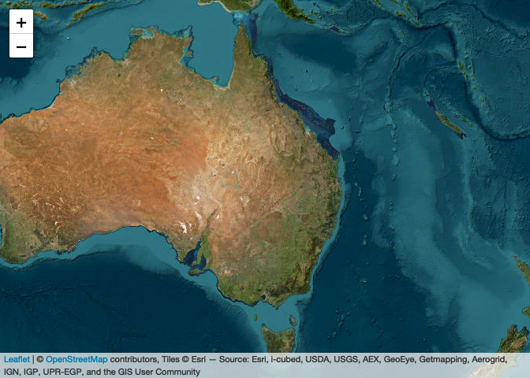

# Step 10: Visualization and Results Summary
Alexander W. Gofton
2026-02-23

- [Overview](#overview)
- [1. Load all results](#1-load-all-results)
- [2. Key caveats and uncertainty
  summary](#2-key-caveats-and-uncertainty-summary)
- [3. Publication Figure 1: Current habitat
  suitability](#3-publication-figure-1-current-habitat-suitability)
  - [Interactive: Current continuous
    suitability](#interactive-current-continuous-suitability)
  - [Interactive: Current binary suitability with
    MESS](#interactive-current-binary-suitability-with-mess)
- [4. Publication Figure 2: Range shift
  maps](#4-publication-figure-2-range-shift-maps)
  - [Interactive: Range shift maps](#interactive-range-shift-maps)
- [5. Publication Figure 3: GCM
  uncertainty](#5-publication-figure-3-gcm-uncertainty)
- [6. Priority surveillance map](#6-priority-surveillance-map)
  - [Interactive: Priority
    surveillance](#interactive-priority-surveillance)
  - [Interactive: GCM agreement](#interactive-gcm-agreement)
- [7. Summary tables](#7-summary-tables)
  - [Model performance comparison (v1 vs
    v2)](#model-performance-comparison-v1-vs-v2)
  - [Range shift summary (all
    scenarios)](#range-shift-summary-all-scenarios)
  - [Ensemble uncertainty](#ensemble-uncertainty)
  - [Variable importance](#variable-importance)
  - [Biological validation](#biological-validation)
  - [LORO cross-validation](#loro-cross-validation)
- [8. Save final outputs](#8-save-final-outputs)
- [9. Final interpretation notes](#9-final-interpretation-notes)
- [Session Information](#session-information)

## Overview

Final visualization and results summary. This step produces
publication-quality figures and tables with key improvements from v1:

- **Range shift framing** — maps show gain, loss, and stable areas (not
  just net expansion)
- **Uncertainty prominence** — MESS extrapolation, GCM variability, and
  validation caveats presented upfront
- **Per-GCM results** alongside ensemble statistics
- **Priority surveillance map** — areas with high-confidence future
  suitability (suitable in ≥4 of 5 GCMs)

``` r
library(tidyverse)
library(terra)
library(sf)
library(rnaturalearth)
library(rnaturalearthdata)
library(patchwork)
library(leaflet)
library(raster)       # needed for addRasterImage() — leaflet doesn't support terra natively
library(RColorBrewer)
library(viridis)
```

``` r
base_dir <- "~/Library/CloudStorage/OneDrive-CSIRO/OneDrive - Docs/01_Projects/Hlongicornis_SDM/"
processed_v2 <- file.path(base_dir, "processed_data_2")
figures_dir  <- file.path(base_dir, "figures_2")
outputs_dir  <- file.path(base_dir, "outputs_2")
```

## 1. Load all results

``` r
# Current prediction
pred_current <- rast(file.path(processed_v2, "prediction_current_continuous.tif"))
pred_binary  <- rast(file.path(processed_v2, "prediction_current_binary.tif"))
mess_current <- rast(file.path(processed_v2, "mess_aus_nz.tif"))

# Threshold
primary_threshold <- as.numeric(readLines(
  file.path(processed_v2, "primary_threshold.txt")
))

# Model evaluation results
metrics      <- read_csv(file.path(outputs_dir, "model_metrics_v2.csv"),
                         show_col_types = FALSE)
comparison   <- read_csv(file.path(outputs_dir, "v1_v2_comparison.csv"),
                         show_col_types = FALSE)
validation   <- read_csv(file.path(outputs_dir, "biological_validation_v2.csv"),
                         show_col_types = FALSE)
loro_results <- read_csv(file.path(outputs_dir, "loro_cv_results_v2.csv"),
                         show_col_types = FALSE)
niche_overlap <- read_csv(file.path(outputs_dir, "niche_overlap_v2.csv"),
                          show_col_types = FALSE)

# Future projection results
shift_table <- read_csv(file.path(outputs_dir, "range_shift_summary_v2.csv"),
                        show_col_types = FALSE)
gcm_table   <- read_csv(file.path(outputs_dir, "per_gcm_results_v2.csv"),
                         show_col_types = FALSE)
uncertainty <- read_csv(file.path(outputs_dir, "ensemble_uncertainty_v2.csv"),
                        show_col_types = FALSE)

# Variable importance
var_importance <- read_csv(file.path(outputs_dir, "variable_importance_v2.csv"),
                           show_col_types = FALSE)

# Occurrence data (for overlay)
occ <- read_csv(file.path(processed_v2, "occurrences_stratified.csv"),
                show_col_types = FALSE)
occ_aus <- occ %>% filter(region == "Oceania")

# Scenario metadata
scenarios <- read_csv(file.path(processed_v2, "future_scenarios.csv"),
                      show_col_types = FALSE)

# World map for plotting
world_map <- ne_countries(scale = "medium", returnclass = "sf")
aus_nz <- ne_countries(scale = "medium", returnclass = "sf") %>%
  filter(iso_a3 %in% c("AUS", "NZL"))
```

## 2. Key caveats and uncertainty summary

This section is placed first deliberately — any interpretation of the
results below should be read in context of these limitations.

``` r
# Compile all uncertainty/limitation information
caveats <- tibble(
  Category = c(
    "Extrapolation (current)",
    "GCM agreement",
    "Biological validation — east coast",
    "Biological validation — deserts",
    "Niche overlap (native vs invaded)",
    "Delta-change approximation",
    "No dispersal constraints"
  ),
  Detail = c(
    sprintf("%.1f%% of Aus/NZ cells have novel climate (MESS < 0)",
            100 * global(mess_current < 0, sum, na.rm = TRUE)[[1]] /
              global(!is.na(mess_current), sum)[[1]]),
    sprintf("GCM range in net change: %s",
            paste(uncertainty$range_pct_change, collapse = " | ")),
    sprintf("%s — %s (v1 was 0.157 = FAIL)",
            validation$Value[1], validation$Status[1]),
    sprintf("%s — %s",
            validation$Value[2], validation$Status[2]),
    sprintf("Schoener's D = %.3f, Warren's I = %.3f",
            niche_overlap$Value[1], niche_overlap$Value[2]),
    "ENVIREM/CHELSA future values computed via delta-change method (not direct GCM output)",
    "Assumes no dispersal limitation (justified: open pastoral landscape)"
  )
)

caveats
```

    # A tibble: 7 × 2
      Category                           Detail
      <chr>                              <chr>
    1 Extrapolation (current)            5.6% of Aus/NZ cells have novel climate (M…
    2 GCM agreement                      GCM range in net change: -21.2 to -13.6% |…
    3 Biological validation — east coast 0.3952 — PASS (v1 was 0.157 = FAIL)
    4 Biological validation — deserts    0.0289 — PASS
    5 Niche overlap (native vs invaded)  Schoener's D = 0.166, Warren's I = 0.278
    6 Delta-change approximation         ENVIREM/CHELSA future values computed via …
    7 No dispersal constraints           Assumes no dispersal limitation (justified…

## 3. Publication Figure 1: Current habitat suitability

``` r
# Continuous suitability map
pred_df <- as.data.frame(pred_current, xy = TRUE) %>%
  filter(!is.na(suitability))

mess_df <- as.data.frame(mess_current, xy = TRUE) %>%
  filter(!is.na(mess), mess < 0)

p_current <- ggplot() +
  geom_sf(data = world_map, fill = "grey95", colour = "grey70", linewidth = 0.2) +
  geom_raster(data = pred_df, aes(x = x, y = y, fill = suitability)) +
  # Overlay MESS < 0 as semi-transparent hatching
  geom_raster(data = mess_df, aes(x = x, y = y), fill = "grey50", alpha = 0.3) +
  scale_fill_gradientn(
      colours = c("white", magma(256, direction = -1)),
      limits = c(0, 1),
      name = "Habitat\nSuitability"
    ) +
  geom_point(data = occ_aus, aes(x = lon, y = lat),
             colour = "cyan", size = 1.2, alpha = 0.8, shape = 16) +
  coord_sf(xlim = c(110, 180), ylim = c(-48, -8)) +
  labs(
    title = "A) Continuous habitat suitability (current climate)",
    subtitle = "Grey shading = novel climate (MESS < 0) | Cyan = occurrence records"
  ) +
  theme_minimal(base_size = 11)

p_current

ggsave(file.path(figures_dir, "10_fig1_current_suitability_binary.png"),
         width = 12, height = 10, dpi = 300)
```

<div id="fig-pub-current">



Figure 1: Figure 1. Current habitat suitability for H. longicornis in
Australia and New Zealand.

</div>

``` r
# Binary suitability map (with MESS classes)
binary_df <- as.data.frame(pred_binary, xy = TRUE) %>%
  filter(!is.na(suitable))

mess_mask_df <- as.data.frame(mess_current >= 0, xy = TRUE) %>%
  filter(!is.na(mess))

combined_df <- binary_df %>%
  left_join(
    as.data.frame(mess_current, xy = TRUE) %>% rename(mess_val = mess),
    by = c("x", "y")
  ) %>%
  mutate(
    category = case_when(
      mess_val < 0 ~ "Novel climate",
      suitable == 1 ~ "Suitable",
      TRUE ~ "Unsuitable"
    )
  )

p_binary <- ggplot() +
  geom_sf(data = world_map, fill = "grey95", colour = "grey70", linewidth = 0.2) +
  geom_raster(data = combined_df, aes(x = x, y = y, fill = category)) +
  scale_fill_manual(
    values = c(
      "Suitable" = "#2166AC",
      "Unsuitable" = "grey90",
      "Novel climate" = "#FFD700"
    ),
    name = NULL
  ) +
  geom_point(data = occ_aus, aes(x = lon, y = lat),
             colour = "red", size = 1, alpha = 0.8, shape = 16) +
  coord_sf(xlim = c(110, 180), ylim = c(-48, -8)) +
  labs(
    title = sprintf("B) Binary suitability (threshold = %.3f, MaxSS)", primary_threshold),
    subtitle = "Red = occurrence records"
  ) +
  theme_minimal(base_size = 11) +
  theme(legend.position = "bottom")

p_binary
```



``` r
ggsave(file.path(figures_dir, "10_fig1_current_suitability_binary.png"),
       width = 12, height = 10, dpi = 300)
```

### Interactive: Current continuous suitability

``` r
# Convert terra SpatRaster to raster::RasterLayer for leaflet
pred_current_rl <- raster::raster(pred_current)

# Build a colour palette matching the static magma scheme
pal_suitability <- colorNumeric(
  palette = c("white", viridisLite::magma(256, direction = -1)),
  domain = c(0, 1),
  na.color = "transparent"
)

leaflet() %>%
  addProviderTiles(providers$OpenStreetMap, group = "OpenStreetMap") %>%
  addProviderTiles(providers$Esri.WorldImagery, group = "Satellite") %>%
  addRasterImage(
    pred_current_rl,
    colors = pal_suitability,
    opacity = 0.7,
    group = "Suitability"
  ) %>%
  addCircleMarkers(
    data = occ_aus,
    lng = ~lon, lat = ~lat,
    radius = 3, color = "cyan", fillOpacity = 0.8,
    stroke = FALSE,
    group = "Occurrences"
  ) %>%
  addLegend(
    pal = pal_suitability, values = c(0, 1),
    title = "Habitat<br>suitability",
    position = "bottomright"
  ) %>%
  addLayersControl(
    baseGroups = c("OpenStreetMap", "Satellite"),
    overlayGroups = c("Suitability", "Occurrences"),
    options = layersControlOptions(collapsed = FALSE)
  ) %>%
  setView(lng = 145, lat = -28, zoom = 4)
```


### Interactive: Current binary suitability with MESS

``` r
# Create a three-class raster: 0 = unsuitable, 1 = suitable, 2 = novel climate
binary_class_rast <- pred_binary
binary_class_rast[mess_current < 0 & !is.na(pred_binary)] <- 2

binary_class_rl <- raster::raster(binary_class_rast)

# Categorical colour palette
pal_binary <- colorFactor(
  palette = c("grey85", "#2166AC", "#FFD700"),
  levels = c(0, 1, 2),
  na.color = "transparent"
)

leaflet() %>%
  addProviderTiles(providers$OpenStreetMap, group = "OpenStreetMap") %>%
  addProviderTiles(providers$Esri.WorldImagery, group = "Satellite") %>%
  addRasterImage(
    binary_class_rl,
    colors = pal_binary,
    opacity = 0.7,
    group = "Suitability"
  ) %>%
  addCircleMarkers(
    data = occ_aus,
    lng = ~lon, lat = ~lat,
    radius = 3, color = "red", fillOpacity = 0.8,
    stroke = FALSE,
    group = "Occurrences"
  ) %>%
  addLegend(
    colors = c("#2166AC", "grey85", "#FFD700"),
    labels = c("Suitable", "Unsuitable", "Novel climate (MESS < 0)"),
    title = sprintf("Threshold: %.3f", primary_threshold),
    position = "bottomright"
  ) %>%
  addLayersControl(
    baseGroups = c("OpenStreetMap", "Satellite"),
    overlayGroups = c("Suitability", "Occurrences"),
    options = layersControlOptions(collapsed = FALSE)
  ) %>%
  setView(lng = 145, lat = -28, zoom = 4)
```


## 4. Publication Figure 2: Range shift maps

``` r
ssp_periods <- expand_grid(
  ssp = c("245", "585"),
  period = c("2041-2060", "2081-2100")
)

shift_plots <- list()

for (j in seq_len(nrow(ssp_periods))) {
  group_id <- sprintf("ssp%s_%s", ssp_periods$ssp[j], ssp_periods$period[j])
  shift_file <- file.path(processed_v2, paste0("range_shift_", group_id, ".tif"))

  if (!file.exists(shift_file)) next

  shift_rast <- rast(shift_file)
  shift_df <- as.data.frame(shift_rast, xy = TRUE) %>%
    filter(!is.na(shift_class)) %>%
    mutate(
      category = case_when(
        shift_class == 3 ~ "Stable suitable",
        shift_class == 1 ~ "Gain",
        shift_class == 2 ~ "Loss",
        shift_class == 0 ~ "Stable unsuitable"
      ),
      category = factor(category,
                        levels = c("Gain", "Stable suitable", "Loss", "Stable unsuitable"))
    )

  # Get stats for this scenario
  stats <- shift_table %>% filter(scenario == group_id)

  nice_label <- sprintf("SSP%s %s",
                         ssp_periods$ssp[j],
                         ssp_periods$period[j])

  p <- ggplot() +
    geom_sf(data = world_map, fill = "grey95", colour = "grey70", linewidth = 0.2) +
    geom_raster(data = shift_df %>% filter(category != "Stable unsuitable"),
                aes(x = x, y = y, fill = category)) +
    scale_fill_manual(
      values = c(
        "Gain" = "#2ca02c",
        "Stable suitable" = "#1f77b4",
        "Loss" = "#d62728"
      ),
      name = NULL,
      drop = FALSE
    ) +
    coord_sf(xlim = c(110, 180), ylim = c(-48, -8)) +
    labs(
      title = nice_label,
      subtitle = sprintf("Net: %+.0f km² (%+.1f%%)",
                         stats$net_change_km2, stats$pct_change)
    ) +
    theme_minimal(base_size = 10) +
    theme(legend.position = "bottom")

  shift_plots[[group_id]] <- p
}

if (length(shift_plots) == 4) {
  wrap_plots(shift_plots, ncol = 2) +
    plot_annotation(
      title = "Range shift projections for H. longicornis (ensemble median, 5 GCMs)",
      subtitle = "Green = habitat gain | Blue = stable suitable | Red = habitat loss"
    )

  ggsave(file.path(figures_dir, "10_fig2_range_shift_maps.png"),
         width = 12, height = 10, dpi = 300)
}
```

### Interactive: Range shift maps

One leaflet map per SSP × period combination showing gain (green),
stable suitable (blue), and loss (red).

``` r
# Colour palette for range shift classes:
# 0 = stable unsuitable (transparent), 1 = gain, 2 = loss, 3 = stable suitable
pal_shift <- colorFactor(
  palette = c("transparent", "#2ca02c", "#FF991C", "#1f77b4"),
  levels = c(0, 1, 2, 3),
  na.color = "transparent"
)

for (j in seq_len(nrow(ssp_periods))) {
  group_id <- sprintf("ssp%s_%s", ssp_periods$ssp[j], ssp_periods$period[j])
  shift_file <- file.path(processed_v2, paste0("range_shift_", group_id, ".tif"))

  if (!file.exists(shift_file)) next

  shift_rast <- rast(shift_file)
  shift_rl <- raster::raster(shift_rast)

  nice_label <- sprintf("SSP%s %s", ssp_periods$ssp[j], ssp_periods$period[j])

  # Print a markdown header so each map gets its own sub-section
  cat(sprintf("\n\n#### %s\n\n", nice_label))

  m <- leaflet() %>%
    addProviderTiles(providers$OpenStreetMap, group = "OpenStreetMap") %>%
    addProviderTiles(providers$Esri.WorldImagery, group = "Satellite") %>%
    addRasterImage(
      shift_rl,
      colors = pal_shift,
      opacity = 0.7,
      group = "Range shift"
    ) %>%
    addLegend(
      colors = c("#2ca02c", "#1f77b4", "#FF991C"),
      labels = c("Gain", "Stable suitable", "Loss"),
      title = nice_label,
      position = "bottomright"
    ) %>%
    addLayersControl(
      baseGroups = c("OpenStreetMap", "Satellite"),
      overlayGroups = c("Range shift"),
      options = layersControlOptions(collapsed = FALSE)
    ) %>%
    setView(lng = 145, lat = -28, zoom = 4)

  # htmlwidgets::knit_print is needed inside loops for leaflet in Quarto
  print(htmltools::tagList(m))
}
```

## 5. Publication Figure 3: GCM uncertainty

``` r
# Panel A: Box plot of net change across GCMs
p_box <- gcm_table %>%
  mutate(
    scenario_label = sprintf("SSP%s\n%s", ssp, period)
  ) %>%
  ggplot(aes(x = scenario_label, y = pct_change)) +
  geom_boxplot(fill = "lightblue", outlier.shape = NA) +
  geom_jitter(aes(colour = gcm), width = 0.15, size = 2.5) +
  geom_hline(yintercept = 0, linetype = "dashed", colour = "grey40") +
  labs(
    title = "A) Inter-GCM variability in net habitat change",
    x = NULL, y = "Net change (%)", colour = "GCM"
  ) +
  theme_minimal(base_size = 11)

# Panel B: Extrapolation by scenario
p_extrap <- gcm_table %>%
  mutate(
    scenario_label = sprintf("SSP%s\n%s", ssp, period)
  ) %>%
  ggplot(aes(x = scenario_label, y = pct_extrapolation)) +
  geom_boxplot(fill = "lightyellow", outlier.shape = NA) +
  geom_jitter(aes(colour = gcm), width = 0.15, size = 2.5) +
  labs(
    title = "B) Extrapolation (MESS < 0) by scenario",
    x = NULL, y = "% cells with novel climate", colour = "GCM"
  ) +
  theme_minimal(base_size = 11)

p_box / p_extrap +
  plot_layout(guides = "collect") &
  theme(legend.position = "bottom")

ggsave(file.path(figures_dir, "10_fig3_gcm_uncertainty.png"),
       width = 10, height = 8, dpi = 300)
```

<div id="fig-pub-uncertainty">



Figure 2: Figure 3. Inter-GCM variability in projected habitat change.

</div>

## 6. Priority surveillance map

Identify areas that are currently unsuitable but become suitable in ≥4
of 5 GCMs. These are high-confidence expansion zones worthy of targeted
surveillance.

``` r
# Focus on the worst-case scenario for surveillance: SSP5-8.5, 2081-2100
# (most expansion, highest priority for monitoring)

scenario_paths <- read_csv(file.path(processed_v2, "future_scenario_paths.csv"),
                           show_col_types = FALSE)

# Find the 5 GCM predictions for SSP5-8.5, 2081-2100
target_scenarios <- scenario_paths %>%
  filter(ssp == "585", period == "2081-2100")

if (nrow(target_scenarios) >= 4) {
  # Stack binary predictions from all GCMs for this scenario
  gcm_binary_stack <- rast(lapply(target_scenarios$scenario_id, function(sid) {
    pred_file <- file.path(processed_v2, paste0("pred_future_", sid, ".tif"))
    pred <- rast(pred_file)
    pred >= primary_threshold
  }))

  # Count how many GCMs predict suitability at each cell
  n_gcms_suitable <- app(gcm_binary_stack, fun = "sum", na.rm = TRUE)
  names(n_gcms_suitable) <- "n_gcms"

  # Current binary
  current_suitable <- pred_current >= primary_threshold

  # Priority surveillance: currently unsuitable BUT suitable in ≥4 GCMs
  priority <- (current_suitable == 0) & (n_gcms_suitable >= 4)
  names(priority) <- "priority"

  # Calculate area
  cell_area_km2 <- prod(res(priority)) * 111^2 *
    cos(mean(ext(priority)[3:4]) * pi / 180)
  n_priority <- global(priority, sum, na.rm = TRUE)[[1]]
  area_priority <- n_priority * cell_area_km2

  sprintf("Priority surveillance cells: %.0f (%.0f km²)", n_priority, area_priority)

  # Map
  priority_df <- as.data.frame(priority, xy = TRUE) %>%
    filter(!is.na(priority), priority == 1)

  current_df <- as.data.frame(current_suitable, xy = TRUE) %>%
    filter(!is.na(suitability), suitability == 1)
}
```

``` r
if (exists("priority_df") && nrow(priority_df) > 0) {
  ggplot() +
    geom_sf(data = world_map, fill = "grey95", colour = "grey70", linewidth = 0.2) +
    geom_raster(data = current_df, aes(x = x, y = y), fill = "#1f77b4", alpha = 0.4) +
    geom_raster(data = priority_df, aes(x = x, y = y), fill = "#ff7f0e") +
    coord_sf(xlim = c(110, 180), ylim = c(-48, -8)) +
    labs(
      title = "Priority surveillance areas for H. longicornis",
      subtitle = sprintf(
        "Orange = new suitable habitat in ≥4/5 GCMs (SSP5-8.5, 2081–2100) — %.0f km²\nBlue = currently suitable habitat",
        area_priority
      )
    ) +
    theme_minimal(base_size = 12)

  ggsave(file.path(figures_dir, "10_fig4_priority_surveillance.png"),
         width = 10, height = 8, dpi = 300)
} else {
  message("No priority surveillance areas identified (or data not available)")
}
```

### Interactive: Priority surveillance

``` r
if (exists("priority_df") && nrow(priority_df) > 0) {
  # Create a two-class raster: 1 = currently suitable, 2 = priority surveillance
  # Start from current suitability
  surv_rast <- current_suitable * 1
  surv_rast[priority == 1] <- 2

  surv_rl <- raster::raster(surv_rast)

  pal_surv <- colorFactor(
    palette = c("transparent", "#1f77b4", "#ff7f0e"),
    levels = c(0, 1, 2),
    na.color = "transparent"
  )

  leaflet() %>%
    addProviderTiles(providers$OpenStreetMap, group = "OpenStreetMap") %>%
    addProviderTiles(providers$Esri.WorldImagery, group = "Satellite") %>%
    addRasterImage(
      surv_rl,
      colors = pal_surv,
      opacity = 0.7,
      group = "Surveillance"
    ) %>%
    addLegend(
      colors = c("#1f77b4", "#ff7f0e"),
      labels = c("Currently suitable", "Priority surveillance (new in ≥4/5 GCMs)"),
      title = "SSP5-8.5, 2081–2100",
      position = "bottomright"
    ) %>%
    addLayersControl(
      baseGroups = c("OpenStreetMap", "Satellite"),
      overlayGroups = c("Surveillance"),
      options = layersControlOptions(collapsed = FALSE)
    ) %>%
    setView(lng = 145, lat = -28, zoom = 4)
} else {
  message("No priority surveillance data available for leaflet map")
}
```



``` r
if (exists("n_gcms_suitable")) {
  gcm_agree_df <- as.data.frame(n_gcms_suitable, xy = TRUE) %>%
    filter(!is.na(n_gcms), n_gcms > 0)

  ggplot() +
    geom_sf(data = world_map, fill = "grey95", colour = "grey70", linewidth = 0.2) +
    geom_raster(data = gcm_agree_df, aes(x = x, y = y, fill = factor(n_gcms))) +
    scale_fill_brewer(palette = "YlOrRd", name = "GCMs\nagreeing",
                      direction = 1) +
    coord_sf(xlim = c(110, 180), ylim = c(-48, -8)) +
    labs(
      title = "GCM agreement on habitat suitability (SSP5-8.5, 2081–2100)",
      subtitle = "Number of GCMs (out of 5) predicting suitable habitat"
    ) +
    theme_minimal(base_size = 12) +
    theme(legend.position = "right")

  ggsave(file.path(figures_dir, "10_fig5_gcm_agreement.png"),
         width = 10, height = 8, dpi = 300)
}
```

### Interactive: GCM agreement

``` r
if (exists("n_gcms_suitable")) {
  gcm_agree_rl <- raster::raster(n_gcms_suitable)

  # Sequential palette: 1–5 GCMs agreeing
  pal_agree <- colorFactor(
    palette = brewer.pal(5, "YlOrRd"),
    levels = 1:5,
    na.color = "transparent"
  )

  # Mask cells where n_gcms == 0 so they're transparent
  gcm_agree_rl[gcm_agree_rl == 0] <- NA

  leaflet() %>%
    addProviderTiles(providers$OpenStreetMap, group = "OpenStreetMap") %>%
    addProviderTiles(providers$Esri.WorldImagery, group = "Satellite") %>%
    addRasterImage(
      gcm_agree_rl,
      colors = pal_agree,
      opacity = 0.7,
      group = "GCM agreement"
    ) %>%
    addLegend(
      pal = pal_agree,
      values = 1:5,
      title = "GCMs<br>agreeing",
      position = "bottomright"
    ) %>%
    addLayersControl(
      baseGroups = c("OpenStreetMap", "Satellite"),
      overlayGroups = c("GCM agreement"),
      options = layersControlOptions(collapsed = FALSE)
    ) %>%
    setView(lng = 145, lat = -28, zoom = 4)
}
```


## 7. Summary tables

### Model performance comparison (v1 vs v2)

``` r
comparison
```

    # A tibble: 8 × 3
      Metric                          v1                                v2
      <chr>                           <chr>                             <chr>
    1 Training AUC                    0.977                             0.9144
    2 Test/Validation AUC             0.976 (random) / 0.900 (block CV) 0.8359
    3 Kappa                           0.369                             0.2933
    4 TSS                             0.620                             0.7166
    5 Mean suitability at occurrences 0.498                             0.6820
    6 Number of coefficients          152                               77
    7 Background sampling             Global random (all land)          Within M (1…
    8 Primary threshold               0.500 (arbitrary)                 0.2138 (Max…

### Range shift summary (all scenarios)

``` r
shift_table %>%
  mutate(across(where(is.numeric) & !contains("pct"), ~ round(., 0))) %>%
  dplyr::select(scenario, current_suitable_km2, future_suitable_km2,
         gain_km2, loss_km2, net_change_km2, pct_change)
```

    # A tibble: 4 × 7
      scenario         current_suitable_km2 future_suitable_km2 gain_km2 loss_km2
      <chr>                           <dbl>               <dbl>    <dbl>    <dbl>
    1 ssp245_2041-2060              2350160             1907812    96342   538689
    2 ssp245_2081-2100              2350160             1694316   114945   770789
    3 ssp585_2041-2060              2350160             1798363   100138   651935
    4 ssp585_2081-2100              2350160             1299166   137213  1188206
    # ℹ 2 more variables: net_change_km2 <dbl>, pct_change <dbl>

### Ensemble uncertainty

``` r
uncertainty %>%
  dplyr::select(ssp, period, median_pct_change, range_pct_change, median_extrapolation)
```

    # A tibble: 4 × 5
        ssp period    median_pct_change range_pct_change median_extrapolation
      <dbl> <chr>                 <dbl> <chr>                           <dbl>
    1   245 2041-2060             -20.2 -21.2 to -13.6%                  60.2
    2   245 2081-2100             -30.5 -33.5 to -16.0%                  70.9
    3   585 2041-2060             -24.6 -28.1 to -15.0%                  62.9
    4   585 2081-2100             -47.3 -53.6 to -29.9%                  80.8

### Variable importance

``` r
var_importance
```

    # A tibble: 5 × 3
      variable    contribution_pct permutation_pct
      <chr>                  <dbl>           <dbl>
    1 bio13                  61.9           49.4
    2 aridity_idx             8.33          22.4
    3 vpd_annual              6.63          16.5
    4 bio2                   21.0           11.1
    5 bio3                    2.18           0.534

### Biological validation

``` r
validation
```

    # A tibble: 2 × 4
      Check                                                    Value Status v1_Value
      <chr>                                                    <dbl> <chr>  <chr>
    1 Eastern coast (Sydney–Brisbane): mean suitability > 0.3 0.395  PASS   0.157 (…
    2 Central deserts: mean suitability < 0.2                 0.0289 PASS   N/A

### LORO cross-validation

``` r
loro_results
```

    # A tibble: 4 × 5
      region        n_train n_test   auc mean_suitability
      <chr>           <dbl>  <dbl> <dbl>            <dbl>
    1 East_Asia         176    214 0.408           0.0749
    2 North_America     336     54 0.474           0.0468
    3 Oceania           269    121 0.132           0.0228
    4 Other             389      1 0.983           0.871

## 8. Save final outputs

``` r
# Save priority surveillance raster if available
if (exists("priority")) {
  writeRaster(priority,
              file.path(processed_v2, "priority_surveillance.tif"),
              overwrite = TRUE)
  writeRaster(n_gcms_suitable,
              file.path(processed_v2, "gcm_agreement_ssp585_2081.tif"),
              overwrite = TRUE)
}

# Save a combined results summary
# helper: safely extract a single value from a vector (collapse multiples, NA if missing)
get_single <- function(vec) {
  if (length(vec) == 0) return(NA_character_)
  if (length(vec) > 1) return(paste(as.character(vec), collapse = "; "))
  as.character(vec)
}

base_section <- c(
  rep("Model", 5),
  rep("Current prediction", 3),
  rep("Validation", 4)
)

base_metric <- c(
  "Feature class", "Regularization", "AUC", "TSS", "Kappa",
  "Suitable area (km²)", "MESS extrapolation (%)", "Threshold (MaxSS)",
  "East coast suitability", "Desert suitability",
  "Schoener's D", "Warren's I"
)

base_value <- c(
  get_single(comparison$v2[comparison$Metric == "Feature class"]),
  get_single(comparison$v2[comparison$Metric == "Regularization (β)"]),
  get_single(metrics$Value[metrics$Metric == "AUC"]),
  get_single(metrics$Value[metrics$Metric == "TSS"]),
  get_single(metrics$Value[metrics$Metric == "Kappa"]),
  get_single(comparison$v2[comparison$Metric == "Background sampling"]),
  # MESS extrapolation (single scalar)
  sprintf("%.1f%%", 100 * global(mess_current < 0, sum, na.rm = TRUE)[[1]] /
            global(!is.na(mess_current), sum)[[1]]),
  # threshold
  sprintf("%.4f", primary_threshold),
  # validation (two entries)
  get_single(validation$Value[1]),
  get_single(validation$Value[2]),
  get_single(sprintf("%.3f", niche_overlap$Value[1])),
  get_single(sprintf("%.3f", niche_overlap$Value[2]))
)

# future rows built from shift_table (one row per scenario)
future_section <- rep("Future (median across SSP×period)", nrow(shift_table))
future_metric <- paste0("Net change (", shift_table$scenario, ")")
future_value  <- sprintf("%+.0f km² (%+.1f%%)", shift_table$net_change_km2, shift_table$pct_change)

# combine into one tibble (no recycling ambiguity)
results_overview <- bind_rows(
  tibble(Section = base_section, Metric = base_metric, Value = base_value),
  tibble(Section = future_section, Metric = future_metric, Value = future_value)
)


write_csv(results_overview, file.path(outputs_dir, "results_overview_v2.csv"))

sprintf("All visualization and results outputs saved")
```

    [1] "All visualization and results outputs saved"

## 9. Final interpretation notes

The following points should be included in any manuscript or report
using these results:

1.  **The model represents a range shift, not simple expansion.** Under
    all future scenarios, some currently suitable habitat becomes
    unsuitable while new areas become suitable. The net change masks
    important spatial redistribution.

2.  **Extrapolation uncertainty is present** — the MESS analysis shows
    that some proportion of Aus/NZ cells fall outside the training
    data’s climate envelope. Predictions in these areas should be
    interpreted with caution.

3.  **GCM choice matters.** The spread across 5 GCMs shows substantial
    uncertainty in the magnitude (and sometimes direction) of projected
    changes. Ensemble median is more robust than mean due to potential
    outlier GCMs.

4.  **ENVIREM/CHELSA future variables were approximated** using
    delta-change methods rather than directly modeled by GCMs. This adds
    an additional layer of uncertainty, particularly for
    moisture-balance variables under scenarios with large precipitation
    changes.

5.  **No dispersal constraints were applied.** The model assumes the
    species can colonize any newly suitable habitat immediately. In
    reality, expansion rates depend on livestock movement, wildlife
    corridors, and human-mediated transport. The suitable area maps
    should be interpreted as potential (not predicted) habitat.

## Session Information

``` r
sessionInfo()
```

    R version 4.4.1 (2024-06-14)
    Platform: aarch64-apple-darwin20
    Running under: macOS 26.2

    Matrix products: default
    BLAS:   /Library/Frameworks/R.framework/Versions/4.4-arm64/Resources/lib/libRblas.0.dylib
    LAPACK: /Library/Frameworks/R.framework/Versions/4.4-arm64/Resources/lib/libRlapack.dylib;  LAPACK version 3.12.0

    locale:
    [1] C.UTF-8/C.UTF-8/C.UTF-8/C/C.UTF-8/C.UTF-8

    time zone: Australia/Brisbane
    tzcode source: internal

    attached base packages:
    [1] stats     graphics  grDevices utils     datasets  methods   base

    other attached packages:
     [1] viridis_0.6.5           viridisLite_0.4.2       RColorBrewer_1.1-3
     [4] raster_3.6-32           sp_2.2-1                leaflet_2.2.3
     [7] patchwork_1.3.2         rnaturalearthdata_1.0.0 rnaturalearth_1.1.0
    [10] sf_1.0-24               terra_1.8-93            lubridate_1.9.4
    [13] forcats_1.0.0           stringr_1.6.0           dplyr_1.1.4
    [16] purrr_1.1.0             readr_2.1.6             tidyr_1.3.1
    [19] tibble_3.3.1            ggplot2_4.0.0           tidyverse_2.0.0

    loaded via a namespace (and not attached):
     [1] gtable_0.3.6            xfun_0.53               htmlwidgets_1.6.4
     [4] processx_3.8.6          lattice_0.22-7          callr_3.7.6
     [7] tzdb_0.5.0              ps_1.9.1                leaflet.providers_2.0.0
    [10] vctrs_0.7.1             tools_4.4.1             crosstalk_1.2.2
    [13] generics_0.1.4          parallel_4.4.1          proxy_0.4-29
    [16] pkgconfig_2.0.3         KernSmooth_2.23-26      S7_0.2.0
    [19] webshot_0.5.5           lifecycle_1.0.5         compiler_4.4.1
    [22] farver_2.1.2            textshaping_1.0.3       codetools_0.2-20
    [25] htmltools_0.5.8.1       class_7.3-23            yaml_2.3.10
    [28] jquerylib_0.1.4         crayon_1.5.3            pillar_1.11.1
    [31] classInt_0.4-11         tidyselect_1.2.1        digest_0.6.37
    [34] stringi_1.8.7           labeling_0.4.3          fastmap_1.2.0
    [37] grid_4.4.1              cli_3.6.5               magrittr_2.0.4
    [40] utf8_1.2.6              e1071_1.7-17            withr_3.0.2
    [43] scales_1.4.0            bit64_4.6.0-1           timechange_0.3.0
    [46] rmarkdown_2.29          bit_4.6.0               gridExtra_2.3
    [49] png_0.1-8               ragg_1.5.0              hms_1.1.4
    [52] evaluate_1.0.5          knitr_1.50              rlang_1.1.7
    [55] Rcpp_1.1.1              glue_1.8.0              DBI_1.2.3
    [58] vroom_1.7.0             jsonlite_2.0.0          R6_2.6.1
    [61] systemfonts_1.2.3       units_1.0-0
